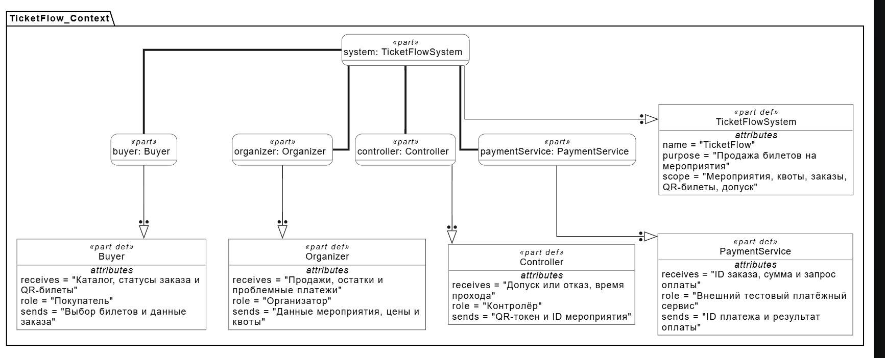

# Спецификация требований к ПО

Для системы продажи билетов на мероприятия «TicketFlow»

Версия 0.1

Подготовил(а) Анастасия Бельская

Белорусский государственный университет информатики и радиоэлектроники

20.10.2026

## Оглавление

<!-- TOC -->
* [1. Введение](#1-введение-1-introduction)
  * [1.1 Назначение документа](#11-назначение-документа-11-document-purpose)
  * [1.2 Область применения продукта](#12-область-применения-продукта-12-product-scope)
  * [1.3 Определения, акронимы и сокращения](#13-определения-акронимы-и-сокращения-13-definitions-acronyms-and-abbreviations)
  * [1.4 Ссылки](#14-ссылки-14-references)
  * [1.5 Обзор документа](#15-обзор-документа-15-document-overview)
* [2. Обзор продукта](#2-обзор-продукта-2-product-overview)
  * [2.1 Перспектива продукта](#21-перспектива-продукта-21-product-perspective)
  * [2.2 Функции продукта](#22-функции-продукта-22-product-functions)
  * [2.3 Ограничения продукта](#23-ограничения-продукта-23-product-constraints)
  * [2.4 Характеристики пользователей](#24-характеристики-пользователей-24-user-characteristics)
  * [2.5 Допущения и зависимости](#25-допущения-и-зависимости-25-assumptions-and-dependencies)
  * [2.6 Распределение требований](#26-распределение-требований-26-apportioning-of-requirements)
* [3. Требования](#3-требования-3-requirements)
  * [3.1 Внешние интерфейсы](#31-внешние-интерфейсы-31-external-interfaces)
    * [3.1.1 Пользовательские интерфейсы](#311-пользовательские-интерфейсы-311-user-interfaces)
    * [3.1.2 Аппаратные интерфейсы](#312-аппаратные-интерфейсы-312-hardware-interfaces)
    * [3.1.3 Программные интерфейсы](#313-программные-интерфейсы-313-software-interfaces)
  * [3.2 Функциональные требования](#32-функциональные-требования-32-functional)
  * [3.3 Качество обслуживания](#33-качество-обслуживания-33-quality-of-service)
    * [3.3.1 Производительность](#331-производительность-331-performance)
    * [3.3.2 Безопасность](#332-безопасность-332-security)
    * [3.3.3 Надёжность](#333-надёжность-333-reliability)
    * [3.3.4 Доступность](#334-доступность-334-availability)
    * [3.3.5 Наблюдаемость](#335-наблюдаемость-335-observability)
  * [3.4 Соответствие стандартам](#34-соответствие-стандартам-34-compliance)
  * [3.5 Проектирование и реализация](#35-проектирование-и-реализация-35-design-and-implementation)
    * [3.5.1 Установка](#351-установка-351-installation)
    * [3.5.2 Сборка и поставка](#352-сборка-и-поставка-352-build-and-delivery)
    * [3.5.3 Распределение](#353-распределение-353-distribution)
    * [3.5.4 Сопровождаемость](#354-сопровождаемость-354-maintainability)
    * [3.5.5 Повторное использование](#355-повторное-использование-355-reusability)
    * [3.5.6 Переносимость](#356-переносимость-356-portability)
    * [3.5.7 Стоимость](#357-стоимость-357-cost)
    * [3.5.8 Сроки](#358-сроки-358-deadline)
    * [3.5.9 Доказательство концепции](#359-доказательство-концепции-359-proof-of-concept)
    * [3.5.10 Управление изменениями](#3510-управление-изменениями-3510-change-management)
  * [3.6 ИИ/МО](#36-иимо-36-aiml)
    * [3.6.1 Спецификация модели](#361-спецификация-модели-361-model-specification)
    * [3.6.2 Управление данными](#362-управление-данными-362-data-management)
    * [3.6.3 Ограничители (Guardrails)](#363-ограничители-guardrails-363-guardrails)
    * [3.6.4 Этика](#364-этика-364-ethics)
    * [3.6.5 Human-in-the-Loop](#365-human-in-the-loop-365-human-in-the-loop)
    * [3.6.6 Жизненный цикл модели и операции](#366-жизненный-цикл-модели-и-операции-366-model-lifecycle-and-operations)
* [4. Верификация](#4-верификация-4-verification)
* [5. Приложения](#5-приложения-5-appendixes)
<!-- TOC -->

## История изменений

| Name | Date | Reason For Changes | Version |
|------|------|--------------------|---------|
| Анастасия Бельская | 20.10.2026 | Первоначальная версия SRS TicketFlow: определены назначение, границы и требования к системе; добавлены критерии проверки и диаграммы SysMLv2 | 0.1 |

---

## 1. Введение {#1-introduction}

Спецификация определяет назначение и проверяемые требования к системе продажи билетов TicketFlow; сведения о продукте приведены в разделе 2, обязательства системы — в разделе 3, способы их проверки — в разделе 4.

### 1.1 Назначение документа {#11-document-purpose}

Настоящая спецификация требований к программному обеспечению (SRS) определяет, что должна делать система продажи билетов TicketFlow, и устанавливает критерии проверки её поведения. Заказчик использует документ для проверки соответствия своим потребностям, разработчик — при проектировании и реализации, а тестировщик и преподаватель — при подготовке испытаний и приёмке результатов. Методы проверки и графические материалы приведены в разделах 4 и 5 и уточняются вместе с требованиями на протяжении разработки.

### 1.2 Область применения продукта {#12-product-scope}

TicketFlow версии 1.0 — веб-приложение для продажи электронных билетов на мероприятия и контроля входа посетителей. Организатор создаёт мероприятия и типы билетов с ценами и квотами, покупатель оформляет и оплачивает заказ, а контролёр проверяет QR-код на входе. Система должна предотвращать продажу сверх квоты и допускать не более одного прохода по билету, обеспечивая учёт продаж и посещений. Учебная версия включает онлайн-оплату в тестовой среде, выдачу билетов в личных заказах и работу со свободным размещением посетителей. Выбор нумерованных мест, возвраты, перепродажа, повторный и офлайн-вход, рассылка билетов, самостоятельная регистрация пользователей и компоненты ИИ/МО в границы версии 1.0 не входят.

### 1.3 Определения, акронимы и сокращения {#13-definitions-acronyms-and-abbreviations}

| Term | Definition |
|------|------------|
| API | Application Programming Interface — программный контракт взаимодействия компонентов и внешних сервисов. |
| BYN | Валюта учебного релиза; 1 BYN равен 100 копейкам. |
| p95 | Время, которое не превышают как минимум 95% ответов. Например, для 100 запросов p95 ≤1 секунды означает минимум 95 ответов за ≤1 секунды; метод вычисления задан в разделе 4. |
| QR-токен | Непредсказуемый идентификатор одного билета, содержащийся в QR-коде. |
| SRS | Software Requirements Specification — документ, определяющий назначение и требования к программному обеспечению. |
| UI | User Interface — пользовательский интерфейс приложения. |
| МБ | Мегабайт: 1 МБ = 1 000 000 байт. |
| ГБ | Гигабайт: 1 ГБ = 1 000 000 000 байт. |
| Билет | Право на один проход на определённое мероприятие, выдаваемое после подтверждения оплаты. |
| Заказ | Покупка от 1 до 5 билетов одного типа на одно мероприятие. |
| Квота | Предельное количество билетов определённого типа, учитывающее продажи и действующие резервы. |
| Контролёр | Пользователь, назначенный проверять билеты конкретного мероприятия. |
| Остаток | Квота минус количество проданных билетов минус количество действующих резервов. |
| Платёжное уведомление | Подтверждённое сообщение платёжного сервиса о результате конкретного платежа. |
| Резерв | Временное удержание билетов за заказом до записанного сервером срока. |
| Тип билета | Категория билетов одного мероприятия с отдельными названием, ценой и квотой. |

### 1.4 Ссылки {#14-references}

| Название | Автор / владелец | Версия | Дата | Расположение | Характер ссылки |
|---|---|---|---|---|---|
| Шаблон SRS | Кафедра ЭВМ БГУИР | Редакция репозитория `5506a34` | 2026; день не указан | [Исходный шаблон SRS](srs-template.md) | Нормативная: структура SRS |
| Примеры текстовой нотации SysMLv2 | Systems Modeling Community | Ветка master; использованные конструкции `part`, `part def`, `attribute`, `connection` | Дата обращения 20.10.2026 | [SysML-v2-Release](https://github.com/Systems-Modeling/SysML-v2-Release) | Справочная: исходники графических моделей |
| Password Storage Cheat Sheet | OWASP Foundation | Редакция на дату обращения | Дата обращения 11.10.2026 | [OWASP](https://cheatsheetseries.owasp.org/cheatsheets/Password_Storage_Cheat_Sheet.html) | Справочная: параметры Argon2id |
| Web Content Accessibility Guidelines | W3C | WCAG 2.2 | Дата обращения 20.10.2026 | [WCAG 2.2](https://www.w3.org/TR/WCAG22/) | Нормативная в объёме критериев, перечисленных в [REQ-INT-004](#req-int-004) |

### 1.5 Обзор документа {#15-document-overview}

Раздел 2 описывает контекст продукта, пользователей, ограничения и зависимости. Раздел 3 содержит функциональные, интерфейсные и качественные требования, а также ограничения реализации. Раздел 4 задаёт методы и матрицу верификации, а раздел 5 содержит графические материалы и вспомогательные данные. Каждое требование обозначено уникальным ID и описано по единой форме из семи полей. Изменения документа фиксируются в таблице истории изменений и связываются с изменениями требований по правилам подраздела 3.5.10.

## 2. Обзор продукта {#2-product-overview}

TicketFlow разрабатывается как новый самостоятельный учебный продукт; его контекст и границы определяют следующие подразделы.

### 2.1 Перспектива продукта {#21-product-perspective}

Система объединяет работу покупателей, организаторов и контролёров через браузер и взаимодействует с внешним тестовым платёжным сервисом. Организатор отвечает за данные своего мероприятия и квоты, покупатель — за выбор заказа, контролёр — за решение о фактическом пропуске после ответа системы. TicketFlow хранит мероприятия, заказы, билеты и факты допуска; внешний сервис обрабатывает форму оплаты и подтверждает её результат, а карточные данные не переходят во владение TicketFlow.

В учебном развёртывании сопровождение выполняет разработчик проекта; круглосуточная коммерческая поддержка не предусматривается. Целевой уровень обслуживания на подготовленном стенде — не менее 99% доступных секунд в часовом контрольном окне согласно [REQ-AVAIL-002](#req-avail-002) и восстановление готовности за 60 секунд после запуска согласно [REQ-AVAIL-001](#req-avail-001). Внешняя недоступность провайдера не считается подтверждением оплаты и обрабатывается правилами интерфейса и резерва.

На контекстной диаграмме часть `system : TicketFlowSystem` представляет TicketFlow, а `buyer`, `organizer`, `controller` и `paymentService` — внешних участников взаимодействия. Обмен данными описан атрибутами `sends` (передаваемые данные) и `receives` (получаемые данные) в определениях участников. Связи соединяют систему с участниками; стрелки с полым треугольником связывают части `part` с определениями их типов `part def`. Внутренние классы приложения, модули и структура БД не изображаются.

### 2.2 Функции продукта {#22-product-functions}

- Создание и публикация мероприятий организатором.
- Создание типов билетов, назначение цен и управление квотами.
- Просмотр каталога и сведений о доступных билетах.
- Вход в учебную учётную запись и работа с личными заказами.
- Оформление заказа и временное резервирование билетов.
- Тестовая онлайн-оплата и выдача отдельных билетов с QR-кодами.
- Сканирование билетов и регистрация однократного входа.
- Просмотр продаж, остатков, посещений и проблемных платежей.

### 2.3 Ограничения продукта {#23-product-constraints}

| Код | Ограничение | Источник и обязательность | Требования раздела 3 |
|---|---|---|---|
| C-01 | Серверная часть должна разрабатываться на Java 17 и собираться Maven | Выбранная платформа проекта; обязательное | [REQ-BUILD-001](#req-build-001) |
| C-02 | Клиент должен быть веб-интерфейсом на русском языке с доступом с ПК и телефона | Тип проекта; обязательное | [REQ-INT-001](#req-int-001), [REQ-INT-004](#req-int-004), [REQ-PORT-001](#req-port-001) |
| C-03 | Онлайн-оплата должна выполняться в тестовой среде без реального списания, через подтверждённые сообщения сервера | Граница учебной эксплуатации; обязательное | [REQ-INT-003](#req-int-003), [REQ-FUNC-009](#req-func-009), [REQ-FUNC-010](#req-func-010), [REQ-FUNC-011](#req-func-011), [REQ-FUNC-012](#req-func-012), [REQ-COST-001](#req-cost-001) |
| C-04 | Продажи должны учитывать квоту и вместимость, а вход — состояние конкретного билета | Назначение продукта; обязательное | [REQ-FUNC-002](#req-func-002), [REQ-FUNC-007](#req-func-007), [REQ-FUNC-014](#req-func-014), [REQ-FUNC-015](#req-func-015), [REQ-FUNC-016](#req-func-016), [REQ-FUNC-017](#req-func-017), [REQ-FUNC-018](#req-func-018) |
| C-05 | Учебный релиз должен поддерживать одну валюту BYN, свободное размещение и только онлайн-проверку входа | Граница версии 1.0; обязательное | [REQ-COMP-001](#req-comp-001), [REQ-FUNC-006](#req-func-006), [REQ-FUNC-016](#req-func-016) |
| C-06 | Учебное развёртывание должно иметь единое серверное состояние, постоянное хранилище и конфигурацию вне исходного кода | Ограничение окружения; обязательное | [REQ-DIST-001](#req-dist-001), [REQ-REL-003](#req-rel-003), [REQ-INST-001](#req-inst-001), [REQ-MAINT-001](#req-maint-001) |
| C-07 | Документация должна следовать шаблону SRS, а изменения должны проходить версионирование и рассмотрение в PR; готовность этапов определяется учебным графиком | Организационное ограничение; обязательное | [REQ-DEAD-001](#req-dead-001), [REQ-CM-001](#req-cm-001) |

Конкретные веб-фреймворк, СУБД и платёжный провайдер не предписываются данной SRS; они выбираются при проектировании с сохранением перечисленных ограничений.

### 2.4 Характеристики пользователей {#24-user-characteristics}

| Класс пользователя | Цель и действия | Подготовка и частота | Доступ и особенности интерфейса |
|---|---|---|---|
| Гость | Выбрать мероприятие и узнать цены | Базовое владение браузером; эпизодически | Только опубликованный каталог; русские подписи и доступ с телефона |
| Покупатель | Оформить заказ, оплатить и предъявить свой билет | Базовое владение браузером; на каждую покупку и посещение | Только свои заказы и билеты; клавиатурное управление формами и текстовые ошибки |
| Организатор | Настроить мероприятие, квоты и назначения; видеть продажи | Знакомство с правилами продажи; несколько раз при подготовке мероприятия и во время продаж | Только свои мероприятия; таблицы с числами, валидация квот и цен |
| Контролёр | Проверять QR и принимать решение о допуске | Инструктаж по статусам и отсутствию связи; многократно во время входа | Только назначенные мероприятия; крупный текст результата, цвет дублируется текстом, камера или файл |

Учётная запись может иметь несколько ролей; права проверяются для каждой операции и конкретного объекта. Доступ к камере запрашивается только на экране контроля входа. Данные карты вводятся на стороне платёжного сервиса.

### 2.5 Допущения и зависимости {#25-assumptions-and-dependencies}

| ID | Допущение или зависимость | Влияние при нарушении | Ответственность и мера снижения риска |
|---|---|---|---|
| A-01 | Учебные учётные записи созданы до демонстрации | Покупатель не сможет создать заказ, сотрудник — управлять мероприятием | Разработчик; инструкция и синтетические учётные записи на стенде |
| A-02 | Контролёр имеет интернет, HTTPS-доступ и камеру либо файл с QR | Сканирование камерой или получение подтверждения недоступно | Организатор; запасной ввод из файла, при потере связи — отказ от неподтверждённого допуска |
| A-03 | Провайдер имеет тестовую среду и проверяемые серверные уведомления | Нельзя доказать онлайн-оплату и подлинность уведомления | Разработчик; до интеграции выбрать сервис и версию API, выполнить [REQ-POC-001](#req-poc-001); для локальных проверок использовать имитатор |
| A-04 | Серверное время согласовано с временем мероприятия; время отображается в Europe/Minsk | Ошибки срока резерва и окна входа | Разработчик стенда; единый источник серверного времени и граничные тесты |
| A-05 | Приёмочный стенд соответствует разделу 4 | Показатели скорости нельзя сопоставить с заданными порогами | Проверяющий; записать характеристики стенда до измерений |
| A-06 | Используются синтетические пользователи и тестовые деньги | Потребуется отдельное определение условий реальной эксплуатации | Владелец учебного стенда; исключить реальные платежи и карточные данные |

Версии СУБД, браузеров и провайдера фиксируются в протоколе соответствующего испытания. Выбор провайдера и точной версии его API выполняется до реализации адаптера; календарные сроки этапов определяются учебным графиком, указанным в подразделе 3.5.8.

### 2.6 Распределение требований {#26-apportioning-of-requirements}

| Подсистема / инкремент | Требования | Поставка |
|---|---|---|
| Каталог, мероприятия, учётные записи | [REQ-FUNC-001](#req-func-001), [REQ-FUNC-002](#req-func-002), [REQ-FUNC-003](#req-func-003), [REQ-FUNC-004](#req-func-004), [REQ-FUNC-005](#req-func-005), [REQ-FUNC-017](#req-func-017), [REQ-FUNC-018](#req-func-018) | 1.0 |
| Заказы, резервы, платежи | [REQ-FUNC-006](#req-func-006), [REQ-FUNC-007](#req-func-007), [REQ-FUNC-008](#req-func-008), [REQ-FUNC-009](#req-func-009), [REQ-FUNC-010](#req-func-010), [REQ-FUNC-011](#req-func-011), [REQ-INT-003](#req-int-003), [REQ-REL-001](#req-rel-001), [REQ-REL-002](#req-rel-002) | 1.0 |
| Билеты и контроль входа | [REQ-FUNC-012](#req-func-012), [REQ-FUNC-013](#req-func-013), [REQ-FUNC-014](#req-func-014), [REQ-FUNC-015](#req-func-015), [REQ-FUNC-016](#req-func-016), [REQ-INT-002](#req-int-002), [REQ-REUSE-001](#req-reuse-001) | 1.0 |
| UI, доступность и переносимость | [REQ-INT-001](#req-int-001), [REQ-INT-004](#req-int-004), [REQ-PORT-001](#req-port-001) | 1.0 |
| Качество и защита | [REQ-PERF-001](#req-perf-001), [REQ-PERF-002](#req-perf-002), [REQ-PERF-003](#req-perf-003), [REQ-SEC-001](#req-sec-001), [REQ-SEC-002](#req-sec-002), [REQ-SEC-003](#req-sec-003), [REQ-SEC-004](#req-sec-004), [REQ-SEC-005](#req-sec-005), [REQ-REL-003](#req-rel-003), [REQ-AVAIL-001](#req-avail-001), [REQ-AVAIL-002](#req-avail-002), [REQ-OBS-001](#req-obs-001), [REQ-COMP-001](#req-comp-001) | 1.0 |
| Развёртывание и сопровождение | [REQ-INST-001](#req-inst-001), [REQ-BUILD-001](#req-build-001), [REQ-DIST-001](#req-dist-001), [REQ-MAINT-001](#req-maint-001), [REQ-MAINT-002](#req-maint-002), [REQ-COST-001](#req-cost-001) | 1.0 |
| Контроль разработки | [REQ-DEAD-001](#req-dead-001), [REQ-POC-001](#req-poc-001), [REQ-CM-001](#req-cm-001) | Этапы подготовки 1.0 |
| Выбор СУБД и платёжного сервиса | Технологические решения определяются при проектировании; зависимость A-03 описана в [подразделе 2.5](#25-допущения-и-зависимости-25-assumptions-and-dependencies) | До интеграции |
| Возвраты билетов | Вне границ 1.0 согласно [подразделу 1.2](#12-область-применения-продукта-12-product-scope); отдельное требование не определено | Отложено; релиз не назначен |
| Выбор нумерованных мест | Вне границ 1.0 согласно [подразделу 1.2](#12-область-применения-продукта-12-product-scope); отдельное требование не определено | Отложено; релиз не назначен |
| Самостоятельная регистрация пользователей | Вне границ 1.0 согласно [подразделу 1.2](#12-область-применения-продукта-12-product-scope); отдельное требование не определено | Отложено; релиз не назначен |
| Офлайн-проверка входа | Вне границ 1.0 согласно [подразделу 1.2](#12-область-применения-продукта-12-product-scope); отдельное требование не определено | Отложено; релиз не назначен |

## 3. Требования {#3-requirements}

Каждое требование содержит поля ID, Title, Statement, Rationale, Acceptance Criteria, Verification Method и More Information. Формулировка «Система должна» задаёт обязательное поведение; проверяемый результат и условия описаны в Acceptance Criteria. Критерии проверяются на стенде и данных раздела 4.

Идентификаторы имеют формат `REQ-[AREA]-[NNN]`, где `AREA` — область требования, `NNN` — трёхзначный порядковый номер внутри области. В этом документе используются FUNC (функции), INT (интерфейсы), PERF (производительность), SEC (безопасность), REL (надёжность), AVAIL (доступность), OBS (наблюдаемость), COMP (совместимость и форматы), INST (установка), BUILD (сборка), DIST (распределение), MAINT (сопровождение), REUSE (повторное использование), PORT (переносимость), COST (стоимость), DEAD (этапы), POC (прототипы) и CM (изменения). Необязательный суффикс `-[VER]` обозначает редакцию требования, например `REQ-FUNC-001-02`; базовая часть ID сохраняется. Изменения фиксируются в истории документа.

### 3.1 Внешние интерфейсы {#31-external-interfaces}

Внешние интерфейсы включают браузерные экраны, камеру и загрузку изображения, а также обмен с тестовым платёжным сервисом; описания контрактов приведены в приложении Б.

#### 3.1.1 Пользовательские интерфейсы {#311-user-interfaces}

Интерфейс имеет общую навигацию «Мероприятия» и «Мои заказы», а действия сотрудников доступны в соответствии с ролью. Основной поток покупателя: каталог → мероприятие → выбор типа и количества → резерв → платёжная страница → личный заказ → QR-билет. Поток контролёра: выбранное назначенное мероприятие → камера или файл → один результат проверки. На экране контроля входа одновременно отображается один результат проверки; перечисленные в структурной схеме успешный допуск, повторный вход и отсутствие связи являются альтернативными результатами.

Пустые списки, ошибки, ожидание платежа и отсутствие связи имеют текстовые сообщения и следующее доступное действие. Помощь по сроку резерва и однократному входу размещается у соответствующего действия. Локализация, клавиатура и видимость фокуса проверяются требованиями ниже; отдельные пользовательские горячие клавиши не задаются.

UI-спецификация: [структурные схемы и описание экранов](ticketflow/ui-specification.md). Используются конкретные критерии WCAG 2.2 из [REQ-INT-004](#req-int-004).

##### REQ-INT-001

- **ID:** REQ-INT-001
- **Title:** Размеры и язык интерфейса
- **Statement:** Система должна отображать основные экраны на русском языке при размерах области браузера 360×640 и 1440×900 CSS-пикселей, без горизонтальной прокрутки страницы.
- **Rationale:** покупатель и контролёр могут работать с телефона, организатор — с компьютера.
- **Acceptance Criteria:** На областях 360×640 и 1440×900 CSS-пикселей все обязательные поля и основные кнопки шести экранов доступны без горизонтальной прокрутки; вертикальная прокрутка разрешена. Для пустого списка, ошибки поля, ожидания оплаты и отказа входа отображается текстовый статус. Ошибки содержат причину и доступное следующее действие. Проверка выполняется при масштабе браузера 100%.
- **Verification Method:** Demonstration
- **More Information:** Ограничения [C-02](#23-ограничения-продукта-23-product-constraints) из подраздела 2.3. [UI-спецификация](ticketflow/ui-specification.md); [контракты](#приложение-б-данные-и-внешние-контракты-версии-10).

##### REQ-INT-004

- **ID:** REQ-INT-004
- **Title:** Управление с клавиатуры и текстовые статусы
- **Statement:** Система должна предоставлять управление формами входа, выбора билета и оплаты с клавиатуры, показывать видимый фокус, связывать каждое поле с текстовой подписью и дублировать смысл цветового статуса текстом.
- **Rationale:** Позволяет использовать основные сценарии без мыши и различать результаты без опоры только на цвет.
- **Acceptance Criteria:** Клавишами Tab, Shift+Tab и Enter выполняется вход, выбор типа, изменение количества и переход к оплате без ловушки фокуса; порядок соответствует чтению экрана сверху вниз. Все поля имеют доступное имя. При скрытом цвете результаты «Вход разрешён», «Билет уже использован» и «Нет подтверждения сервера» различимы. Применяются критерии WCAG 2.2: 1.3.1, 1.4.1, 2.1.1 и 2.4.7; полное соответствие всем критериям WCAG не заявляется.
- **Verification Method:** Demonstration
- **More Information:** Ограничения [C-02](#23-ограничения-продукта-23-product-constraints) из подраздела 2.3. [UI-спецификация](ticketflow/ui-specification.md); [контракты](#приложение-б-данные-и-внешние-контракты-версии-10).

#### 3.1.2 Аппаратные интерфейсы {#312-hardware-interfaces}

Клиентские устройства — ПК с клавиатурой и смартфон с камерой; промышленные турникеты и специальные аппаратные сканеры не входят в аппаратный интерфейс 1.0. Браузер получает видеопоток только после разрешения пользователя и передаёт серверу распознанный токен, а не непрерывное видео. Альтернативный вход — файл PNG/JPEG. Протокол передачи серверу — HTTPS; электрические сигналы и аппаратные тайминги приложением не управляются. Срок ответа сервера после распознавания задаёт [REQ-PERF-003](#req-perf-003).

##### REQ-INT-002

- **ID:** REQ-INT-002
- **Title:** Получение QR-кода
- **Statement:** Система должна предоставлять контролёру ввод QR-кода с камеры устройства и из загружаемого PNG/JPEG-файла размером до 5 МБ.
- **Rationale:** загрузка файла даёт резервный способ проверки при отказе в доступе к камере.
- **Acceptance Criteria:** обе формы ввода дают один результат для одного QR-токена; отказ в доступе к камере не вызывает допуск и оставляет доступной загрузку; файл 5 МБ принимается, файл 5 МБ + 1 байт отклоняется; файл без распознаваемого QR даёт «QR-код не распознан» без изменения билетов.
- **Verification Method:** Demonstration
- **More Information:** Ограничения [C-02](#23-ограничения-продукта-23-product-constraints), [C-05](#23-ограничения-продукта-23-product-constraints) из подраздела 2.3. [UI-спецификация](ticketflow/ui-specification.md); [контракты](#приложение-б-данные-и-внешние-контракты-версии-10).

#### 3.1.3 Программные интерфейсы {#313-software-interfaces}

Платёжный интерфейс версии 1.0 определён в приложении Б: он включает запрос сессии оплаты и уведомление о результате. Владельцем цены заказа и выданных билетов остаётся TicketFlow, владельцем данных формы оплаты — внешний сервис. Покупатель аутентифицируется своей сессией; серверное уведомление проверяется независимо от браузера. Для локального имитатора используется подписанный контракт приложения Б, адаптер провайдера проверяет подлинность по спецификации выбранного сервиса.

При отсутствии ответа внешнего сервиса в течение 5 секунд интерфейс сообщает, что платёжная сессия не подтверждена, и предлагает повтор того же запроса без создания второй сессии. Тело входящего уведомления ограничено 16 KiB; неизвестная версия контракта и несовпадающие обязательные поля отклоняются без выдачи билетов. Изменения совместимых необязательных полей сохраняют версию 1.0; изменение семантики обязательного поля требует новой основной версии контракта и правил миграции из подраздела 3.5.10.

##### REQ-INT-003

- **ID:** REQ-INT-003
- **Title:** Контракт оплаты
- **Statement:** Система должна обмениваться с тестовым платёжным сервисом по контракту версии 1.0 из приложения Б: передавать ID заказа, сумму целым числом копеек, BYN и адрес возврата, принимать подлинное уведомление с ID события и платежа, ID заказа, суммой, валютой и результатом.
- **Rationale:** выдача билета должна зависеть от подтверждения сервера платежей.
- **Acceptance Criteria:** На исходно неоплаченном заказе проверяются успех, отказ, задержка, повтор, неверная сумма, неверная валюта и неподлинное уведомление. Неподлинное или несовпадающее сообщение не меняет заказ и не создаёт новых билетов; возвращённая браузером страница не подтверждает оплату. Контракт версии 1.0 и поля сообщения определены в приложении Б; конкретный провайдер реализуется через адаптер этого контракта. Таймаут создания сессии — 5 секунд; повтор возвращает ту же сессию. Уведомление размером 16 KiB принимается при корректном содержимом, 16 KiB + 1 байт отклоняется; неизвестная основная версия не изменяет заказ.
- **Verification Method:** Demonstration
- **More Information:** Ограничения [C-03](#23-ограничения-продукта-23-product-constraints) из подраздела 2.3. [UI-спецификация](ticketflow/ui-specification.md); [контракты](#приложение-б-данные-и-внешние-контракты-версии-10).

### 3.2 Функциональные требования {#32-functional}

Требования организованы по пользовательскому сценарию: подготовка мероприятия и каталог, вход, создание и оплата заказа, получение билета, контроль входа и сводка организатора. В каждом критерии определены наблюдаемые выходы и недопустимые ситуации; внутренний алгоритм обработки не предписывается.

##### REQ-FUNC-001

- **ID:** REQ-FUNC-001
- **Title:** Создание мероприятия
- **Statement:** Система должна предоставлять организатору создание мероприятия с названием 3–100 символов, описанием до 2 000 символов, местом 3–200 символов, временем начала и окончания и вместимостью 1–10 000 человек.
- **Rationale:** задаёт данные для продажи и проверки входа.
- **Acceptance Criteria:** Название длиной 3 и 100 символов, место длиной 3 и 200 символов, описание длиной 0 и 2 000 символов и вместимость 1 и 10 000 принимаются; соседние значения за границей отклоняются без сохранения. Название и место из одних пробелов отклоняются. Начало позже текущего серверного времени, окончание позже начала; равенство дат отклоняется. Начальный статус — «Черновик», владелец — текущий организатор.
- **Verification Method:** Test
- **More Information:** Ограничения [C-04](#23-ограничения-продукта-23-product-constraints) из подраздела 2.3.

##### REQ-FUNC-002

- **ID:** REQ-FUNC-002
- **Title:** Типы билетов
- **Statement:** Система должна предоставлять организатору создание от 1 до 5 типов билетов своего мероприятия с уникальным названием 2–50 символов, ценой 0,01–10 000,00 BYN с точностью 0,01 BYN и квотой 1–10 000 билетов.
- **Rationale:** задаёт категории продажи и лимиты.
- **Acceptance Criteria:** Шестой тип, название длиной 1 или 51 символ, повтор названия после удаления крайних пробелов без учёта регистра, цена 0 или 10 000,01 BYN, цена с 3 дробными знаками, квота 0 и превышение вместимости суммой квот отклоняются. Названия длиной 2 и 50, цены 0,01 и 10 000,00 BYN, квоты 1 и 10 000 принимаются при допустимой вместимости. Денежные расчёты дают точное число копеек.
- **Verification Method:** Test
- **More Information:** Ограничения [C-04](#23-ограничения-продукта-23-product-constraints) из подраздела 2.3.

##### REQ-FUNC-003

- **ID:** REQ-FUNC-003
- **Title:** Публикация и закрытие продаж
- **Statement:** Система должна разрешать публикацию мероприятия только с заполненными обязательными полями и минимум одним типом билета; создавать новые заказы только для опубликованного мероприятия до времени его начала.
- **Rationale:** исключает продажу неподготовленных и уже начавшихся мероприятий.
- **Acceptance Criteria:** Черновик скрыт от гостей; публикация без типа билета отклоняется; создание заказа ровно во время начала мероприятия отклоняется. Успешное создание до начала допускается при наличии квоты. Срок резерва равен меньшему из значений «создан + 600 секунд» и «окончание мероприятия»; заказ не может быть оплачен после окончания мероприятия.
- **Verification Method:** Test
- **More Information:** Ограничения [C-04](#23-ограничения-продукта-23-product-constraints), [C-05](#23-ограничения-продукта-23-product-constraints) из подраздела 2.3.

##### REQ-FUNC-004

- **ID:** REQ-FUNC-004
- **Title:** Каталог мероприятий
- **Statement:** Система должна показывать предстоящие опубликованные мероприятия по 10 на страницу, в порядке времени начала с дополнительной сортировкой по ID при одинаковом времени.
- **Rationale:** даёт воспроизводимый способ выбора мероприятия.
- **Acceptance Criteria:** для 23 доступных мероприятий страницы содержат 10, 10 и 3 записи без повторов; карточка показывает дату, место, минимальную цену и остаток каждого типа; при 0 записях отображается «Нет доступных мероприятий».
- **Verification Method:** Test
- **More Information:** Ограничения [C-02](#23-ограничения-продукта-23-product-constraints) из подраздела 2.3.

##### REQ-FUNC-005

- **ID:** REQ-FUNC-005
- **Title:** Вход и выход
- **Statement:** Система должна допускать вход по логину и паролю существующей учебной учётной записи, а при выходе прекращать действие её текущей сессии.
- **Rationale:** позволяет связывать заказы и права с пользователем.
- **Acceptance Criteria:** правильные данные открывают разрешённые действия; неправильные дают общее сообщение «Неверный логин или пароль»; после выхода повторный защищённый запрос прежней сессии отклоняется. Гость может просматривать каталог, но не создать заказ.
- **Verification Method:** Test
- **More Information:** Ограничения [C-02](#23-ограничения-продукта-23-product-constraints) из подраздела 2.3.

##### REQ-FUNC-006

- **ID:** REQ-FUNC-006
- **Title:** Создание заказа и расчёт суммы
- **Statement:** Система должна предоставлять покупателю заказ от 1 до 5 билетов одного типа на одно мероприятие и при создании заказа фиксировать на сервере цену единицы, количество и итоговую сумму.
- **Rationale:** исключает неоднозначность цены и подмену суммы клиентом.
- **Acceptance Criteria:** количество 0 и 6 отклоняется; заказ 3 билетов по 25,50 BYN даёт 76,50 BYN; присланная клиентом цена игнорируется; изменение цены типа не изменяет уже созданный заказ.
- **Verification Method:** Test
- **More Information:** Ограничения [C-04](#23-ограничения-продукта-23-product-constraints), [C-05](#23-ограничения-продукта-23-product-constraints) из подраздела 2.3.

##### REQ-FUNC-007

- **ID:** REQ-FUNC-007
- **Title:** Резерв и соблюдение квоты
- **Statement:** Система должна при создании заказа атомарно резервировать количество билетов до меньшего из моментов «создан + 600 секунд» и «окончание мероприятия», если остаток достаточен; при недостаточном остатке отклонять запрос без создания заказа и платёжной сессии.
- **Rationale:** выполняет BG-01 при одновременных покупках.
- **Acceptance Criteria:** при остатке 5 и 20 одновременных запросах по 1 билету ровно 5 запросов получают резерв, 15 получают отказ; продано + зарезервировано никогда не превышает квоту. Два запроса на последние 3 билета получают не более одного успешного заказа.
- **Verification Method:** Test
- **More Information:** Ограничения [C-04](#23-ограничения-продукта-23-product-constraints) из подраздела 2.3.

##### REQ-FUNC-008

- **ID:** REQ-FUNC-008
- **Title:** Окончание резерва
- **Statement:** Система должна при достижении записанного срока резерва переводить неоплаченный заказ в «Истёк» и освобождать его резерв не позднее чем через 15 секунд после этой границы.
- **Rationale:** неоплаченные заказы не должны бессрочно удерживать квоту.
- **Acceptance Criteria:** Для мероприятия с окончанием более чем через 600 секунд резерв действует до «создан + 600 секунд»; для более раннего окончания — до окончания мероприятия. На границе новый платёж не инициируется и успешное уведомление считается поздним; за последующие 15 секунд квота освобождается ровно один раз. Обратный отсчёт в интерфейсе использует серверный срок.
- **Verification Method:** Test
- **More Information:** Ограничения [C-04](#23-ограничения-продукта-23-product-constraints) из подраздела 2.3.

##### REQ-FUNC-009

- **ID:** REQ-FUNC-009
- **Title:** Начало оплаты
- **Statement:** Система должна открывать тестовую платёжную сессию только для принадлежащего покупателю действующего заказа, используя зафиксированную сумму; повтор запроса должен возвращать ту же платёжную сессию.
- **Rationale:** предотвращает двойную оплату при повторном нажатии.
- **Acceptance Criteria:** 10 повторных запросов для одного заказа создают 1 платёжную сессию; чужой, оплаченный или истёкший заказ отклоняется. Пока нет подтверждения сервера, интерфейс показывает «Ожидает оплаты».
- **Verification Method:** Test
- **More Information:** Ограничения [C-04](#23-ограничения-продукта-23-product-constraints), [C-05](#23-ограничения-продукта-23-product-constraints) из подраздела 2.3.

##### REQ-FUNC-010

- **ID:** REQ-FUNC-010
- **Title:** Подтверждение и отказ оплаты
- **Statement:** Система должна переводить заказ «Ожидает оплаты» в «Оплачен» только по подлинному успешному уведомлению с совпадающими заказом, платёжной сессией, суммой и валютой, принятому сервером до срока резерва; подлинный отказ для действующего заказа должен переводить его в «Оплата отклонена» и освобождать резерв.
- **Rationale:** выполняет BG-02 и исключает выдачу неоплаченных билетов.
- **Acceptance Criteria:** Для действующего заказа успех преобразует резерв в продажу без изменения суммы «продано + резерв»; отказ освобождает резерв за ≤15 секунд. Неподлинное или несовпадающее уведомление не меняет заказ и не выдаёт билетов. Повтор и более поздний отказ не отменяют ранее сохранённую успешную оплату. После подлинного отказа повторная покупка оформляется новым заказом.
- **Verification Method:** Test
- **More Information:** Ограничения [C-04](#23-ограничения-продукта-23-product-constraints), [C-05](#23-ограничения-продукта-23-product-constraints) из подраздела 2.3.

##### REQ-FUNC-011

- **ID:** REQ-FUNC-011
- **Title:** Позднее подтверждение платежа
- **Statement:** Система должна при получении подлинного успеха платежа для неоплаченного заказа в момент истечения его резерва или позже переводить заказ в «Требует проверки», не выдавая билетов и не занимая повторно освобождённую квоту.
- **Rationale:** поздний платёж не должен приводить к продаже сверх квоты.
- **Acceptance Criteria:** На неоплаченном заказе сообщения ровно на границе срока и позже переводят заказ в «Требует проверки»; заказ появляется в списке проблемных платежей организатора. Новые билеты не выдаются, проданная квота не увеличивается; остаток освобождается за ≤15 секунд от срока резерва. Покупатель видит «Платёж требует проверки организатором»; повтор сообщения не создаёт вторую проблемную запись. Автоматическое денежное возмещение не входит в учебную версию; используется тестовая оплата.
- **Verification Method:** Test
- **More Information:** Ограничения [C-04](#23-ограничения-продукта-23-product-constraints), [C-05](#23-ограничения-продукта-23-product-constraints) из подраздела 2.3.

##### REQ-FUNC-012

- **ID:** REQ-FUNC-012
- **Title:** Выдача электронных билетов
- **Statement:** Система должна за ≤5 секунд после принятия подтверждения оплаты создать и предоставить покупателю ровно столько отдельных электронных билетов, сколько указано в заказе.
- **Rationale:** выполняет BG-02 и позволяет раздельно проверять вход нескольких посетителей.
- **Acceptance Criteria:** заказ 3 билетов создаёт 3 разных ID и QR-токена; каждый билет показывает мероприятие, дату, место, тип, цену и состояние. Неоплаченный заказ содержит 0 билетов. Выдача сохраняется на сервере; повторное открытие не генерирует новые токены.
- **Verification Method:** Test
- **More Information:** Ограничения [C-04](#23-ограничения-продукта-23-product-constraints), [C-05](#23-ограничения-продукта-23-product-constraints) из подраздела 2.3.

##### REQ-FUNC-013

- **ID:** REQ-FUNC-013
- **Title:** Личные заказы и билеты
- **Statement:** Система должна показывать покупателю только его заказы, по 10 на страницу от новых к старым, и позволять открыть принадлежащие ему билеты.
- **Rationale:** покупатель должен иметь доступ к результату покупки.
- **Acceptance Criteria:** пользователь А не видит и не получает по прямой ссылке заказ или QR пользователя Б; при отсутствии покупок показано «У вас пока нет заказов»; статусы оплаченного, истёкшего и проблемного заказа различимы текстом.
- **Verification Method:** Test
- **More Information:** Ограничения [C-02](#23-ограничения-продукта-23-product-constraints) из подраздела 2.3.

##### REQ-FUNC-014

- **ID:** REQ-FUNC-014
- **Title:** Первый допуск
- **Statement:** Система должна разрешать вход по неиспользованному билету оплаченного заказа только контролёру соответствующего мероприятия и только от времени начала минус 60 минут включительно до времени окончания исключительно.
- **Rationale:** выполняет BG-03 в определённом временном окне.
- **Acceptance Criteria:** успешная проверка фиксирует состояние «Использован», серверное время и контролёра; результат содержит «Вход разрешён», мероприятие, тип и номер билета. Проверки точно на открытии входа принимаются, точно на окончании — отклоняются.
- **Verification Method:** Test
- **More Information:** Ограничения [C-04](#23-ограничения-продукта-23-product-constraints), [C-05](#23-ограничения-продукта-23-product-constraints) из подраздела 2.3.

##### REQ-FUNC-015

- **ID:** REQ-FUNC-015
- **Title:** Повторное сканирование
- **Statement:** Система должна допускать по одному билету не более 1 успешного прохода, в том числе при одновременном сканировании разными контролёрами.
- **Rationale:** предотвращает повторный проход по копии QR.
- **Acceptance Criteria:** из 10 одновременных проверок одного допустимого билета ровно 1 даёт «Вход разрешён», 9 — «Билет уже использован»; число использованных билетов увеличивается на 1. Повтор показывает время первого допуска, не изменяя его.
- **Verification Method:** Test
- **More Information:** Ограничения [C-04](#23-ограничения-продукта-23-product-constraints), [C-05](#23-ограничения-продукта-23-product-constraints) из подраздела 2.3.

##### REQ-FUNC-016

- **ID:** REQ-FUNC-016
- **Title:** Отказы при проверке
- **Statement:** Система должна отклонять неизвестный или повреждённый QR, билет другого мероприятия, проверку вне временного окна и проверку без подтверждённого серверного ответа, не изменяя билет и счётчик входов.
- **Rationale:** ошибки и отсутствие связи не должны превращаться в допуск.
- **Acceptance Criteria:** причины различаются текстом: «Билет не найден», «Другое мероприятие», «Вход ещё не открыт», «Мероприятие завершено», «Нет подтверждения сервера». При сетевой неопределённости интерфейс предлагает повтор; если первая проверка была принята сервером, повтор показывает уже использованный билет.
- **Verification Method:** Test
- **More Information:** Ограничения [C-04](#23-ограничения-продукта-23-product-constraints), [C-05](#23-ограничения-продукта-23-product-constraints) из подраздела 2.3.

##### REQ-FUNC-017

- **ID:** REQ-FUNC-017
- **Title:** Изменение квоты и назначения
- **Statement:** Система должна предоставлять организатору изменение цены будущих заказов, изменение квот и назначение существующих контролёров на свои мероприятия; уменьшение квоты ниже суммы проданных билетов и действующих резервов должно отклоняться.
- **Rationale:** управление продажами должно сохранять ранее принятые обязательства.
- **Acceptance Criteria:** При 40 проданных и 5 зарезервированных билетах квота 44 отклоняется, 45 принимается при допустимой вместимости; конкурентное изменение с резервированием сохраняет тот же инвариант. Сумма квот больше вместимости отклоняется. Назначенный контролёр получает права только на выбранное мероприятие; снятое назначение запрещает следующий запрос проверки. Даты, место и вместимость после публикации не редактируются.
- **Verification Method:** Test
- **More Information:** Ограничения [C-04](#23-ограничения-продукта-23-product-constraints) из подраздела 2.3.

##### REQ-FUNC-018

- **ID:** REQ-FUNC-018
- **Title:** Сводка организатора
- **Statement:** Система должна показывать владельцу мероприятия по каждому типу квоту, число проданных, число действующих резервов и остаток, а также общую сумму оплаченных заказов, число допусков и список заказов, требующих проверки.
- **Rationale:** выполняет BG-04 и делает видимыми проблемные платежи.
- **Acceptance Criteria:** для квоты 100, 40 продаж и 5 резервов остаток равен 55; 40 продаж по 25 BYN дают 1 000,00 BYN; 12 использованных билетов дают 12 допусков. Истёкшие, отклонённые и требующие проверки заказы не входят в сумму продаж. После обновления страницы данные соответствуют сохранённому состоянию; автоматическое обновление не требуется.
- **Verification Method:** Test
- **More Information:** Ограничения [C-04](#23-ограничения-продукта-23-product-constraints) из подраздела 2.3.

### 3.3 Качество обслуживания {#33-quality-of-service}

Показатели качества действуют в условиях раздела 4; данные об их фактическом выполнении заносятся в матрицу только после испытаний. Временные требования к оплате относятся к серверному сценарию с имитатором, а не ко времени принятия решения покупателем или банком.

#### 3.3.1 Производительность {#331-performance}

Нагрузка учебного релиза ограничена 20 одновременно активными пользователями основных экранов и 5 одновременно работающими контролёрами. Объём данных для проверки — 100 мероприятий, 2 000 оплаченных заказов по 5 билетов и 10 000 билетов. Пиковая пакетная нагрузка задаётся отдельно: 50 покупок при максимум 10 одновременно выполняемых сценариях. Эти пределы выбраны для воспроизводимого учебного стенда; гарантии промышленного масштаба и жёсткого реального времени не устанавливаются. Объём файлов QR ограничен [REQ-INT-002](#req-int-002), допустимые диапазоны бизнес-данных — [REQ-FUNC-001](#req-func-001)–002.

##### REQ-PERF-001

- **ID:** REQ-PERF-001
- **Title:** Время ответа основных операций
- **Statement:** Система должна при 20 одновременно активных пользователях в течение 10 минут обеспечивать p95 времени ответа ≤2 секунд и максимум ≤5 секунд для каталога, создания резерва и просмотра личных заказов, измеряемых раздельно.
- **Rationale:** заменяет субъективное требование «система быстрая» измеримым порогом.
- **Acceptance Criteria:** минимум 200 запросов каждого вида после прогрева; каждому пользователю задаётся пауза 1 секунда после ответа. Нет неожиданных ошибок сервера; внешняя форма оплаты не входит в измерение. Ошибки валидации и дефицит билетов считаются корректными только в предназначенных для них сценариях.
- **Verification Method:** Test
- **More Information:** Ограничения [C-02](#23-ограничения-продукта-23-product-constraints), [C-06](#23-ограничения-продукта-23-product-constraints) из подраздела 2.3.

##### REQ-PERF-002

- **ID:** REQ-PERF-002
- **Title:** Пакет из 50 заказов
- **Statement:** Система должна завершать обработку 50 заказов по 1 билету за ≤30 секунд при максимум 10 одновременно выполняющихся сценариях и ответах платёжного имитатора за ≤100 миллисекунд.
- **Rationale:** задаёт конкретный объём обработки платежей и выдачи билетов.
- **Acceptance Criteria:** время считается от отправки первого запроса создания заказа до сохранения и доступности всех 50 QR-билетов; квота перед запуском не менее 100; все 50 заказов оплачены и имеют по 1 билету. Ручной ввод данных и ожидание пользователя исключены. Каждая из 3 последовательных серий на чистых данных укладывается в 30 секунд.
- **Verification Method:** Test
- **More Information:** Ограничения [C-02](#23-ограничения-продукта-23-product-constraints), [C-06](#23-ограничения-продукта-23-product-constraints) из подраздела 2.3.

##### REQ-PERF-003

- **ID:** REQ-PERF-003
- **Title:** Скорость проверки входа
- **Statement:** Система должна при 5 одновременно работающих контролёрах обеспечивать для 100 запросов проверки билетов p95 времени ответа ≤1 секунды и максимум ≤3 секунд, считая от отправки распознанного токена до получения полного ответа.
- **Rationale:** снижает задержки принятия решения у входа.
- **Acceptance Criteria:** 50 допустимых билетов, 25 повторов и 25 неизвестных токенов; минимум 95 ответов получены за ≤1 секунды, все — за ≤3 секунд. Фокусировка камеры и декодирование изображения не включены; проверка квот и статусов не отключается.
- **Verification Method:** Test
- **More Information:** Ограничения [C-02](#23-ограничения-продукта-23-product-constraints), [C-06](#23-ограничения-продукта-23-product-constraints) из подраздела 2.3.

#### 3.3.2 Безопасность {#332-security}

Общие средства защиты распространяются на все защищённые операции. Доступ по ролям и объектам задан [REQ-SEC-001](#req-sec-001), защита QR — [REQ-SEC-002](#req-sec-002), паролей и передачи данных — [REQ-SEC-003](#req-sec-003), недоверенного ввода — [REQ-SEC-004](#req-sec-004), сессий и попыток входа — [REQ-SEC-005](#req-sec-005). Базовое состояние доступа — запрет до подтверждения прав; пользователь получает только сведения своего объекта. Нарушения аутентификации и недостоверные уведомления фиксируются по [REQ-OBS-001](#req-obs-001); обработка внешнего контракта остаётся в подразделе 3.1.3.

##### REQ-SEC-001

- **ID:** REQ-SEC-001
- **Title:** Проверка прав на сервере
- **Statement:** Система должна проверять роль, владельца объекта и назначение на мероприятие при каждом защищённом запросе, независимо от видимости кнопок в интерфейсе.
- **Rationale:** клиентский интерфейс не является границей доступа.
- **Acceptance Criteria:** Для каждой комбинации роли, операции и владельца из матрицы приложения В выполняется минимум один запрос; все запрещённые комбинации дают 0 изменений и 0 раскрытых чужих заказов или QR-токенов. Пользователь без сессии получает HTTP 401, вошедший без права — HTTP 403, запрос чужого личного заказа — HTTP 404 без его содержимого. Разрешённые комбинации дают заявленное действие.
- **Verification Method:** Test
- **More Information:** Ограничения [C-02](#23-ограничения-продукта-23-product-constraints), [C-03](#23-ограничения-продукта-23-product-constraints), [C-06](#23-ограничения-продукта-23-product-constraints) из подраздела 2.3.

##### REQ-SEC-002

- **ID:** REQ-SEC-002
- **Title:** Защита QR-токенов
- **Statement:** Система должна назначать каждому билету криптографически случайный QR-токен, сформированный не менее чем из 16 случайных байтов (128 бит); QR-код должен содержать только токен либо ссылку с ним, без пароля, платёжных данных и сведений о покупателе.
- **Rationale:** препятствует угадыванию билетов и раскрытию данных через QR.
- **Acceptance Criteria:** инспекция подтверждает криптографически стойкий генератор и минимум 16 случайных байтов (128 бит) на токен; в выборке 10 000 токенов нет повторов; декодирование QR не раскрывает исключённые данные. Отсутствие повторов само по себе не доказывает качество генератора.
- **Verification Method:** Inspection
- **More Information:** Ограничения [C-02](#23-ограничения-продукта-23-product-constraints), [C-03](#23-ограничения-продукта-23-product-constraints), [C-06](#23-ограничения-продукта-23-product-constraints) из подраздела 2.3.

##### REQ-SEC-003

- **ID:** REQ-SEC-003
- **Title:** Учётные данные и платежи
- **Statement:** Система должна хранить пароли только в виде хеша Argon2id с памятью не менее 20 МБ, не менее 2 проходов, параллелизмом 1 и отдельной случайной солью не менее 16 байт; не хранить номер банковской карты и CVV; передавать пароли, QR-токены и платёжные сообщения по HTTPS в демонстрационной среде.
- **Rationale:** ограничивает обработку чувствительных данных учебным приложением.
- **Acceptance Criteria:** Память Argon2id ≥20 МБ, проходы ≥2, параллелизм 1, случайная соль ≥16 байт; одинаковые пароли двух пользователей имеют разные хеши и соли. БД и журналы не содержат открытых паролей, номеров карт и CVV. Пароль входа передаётся только по HTTPS, данные карты вводятся на странице тестового платёжного сервиса. Алгоритм и параметры проверяются инспекцией; требования к передаче платёжных уведомлений заданы [REQ-INT-003](#req-int-003).
- **Verification Method:** Inspection
- **More Information:** Ограничения [C-02](#23-ограничения-продукта-23-product-constraints), [C-03](#23-ограничения-продукта-23-product-constraints), [C-06](#23-ограничения-продукта-23-product-constraints) из подраздела 2.3.

##### REQ-SEC-004

- **ID:** REQ-SEC-004
- **Title:** Обработка недоверенного ввода
- **Statement:** Система должна обрабатывать пользовательские строки как данные, не исполнять содержащиеся в них SQL- и HTML/JavaScript-команды и отклонять запросы изменения данных без подтверждения их происхождения из текущей сессии.
- **Rationale:** Защищает содержимое мероприятий, заказов и квот от инъекций и подделки запросов.
- **Acceptance Criteria:** Набор из 20 строк SQL/HTML/JavaScript в поиске и названии не вызывает исполнения команд, изменения посторонних данных и скриптов в браузере. Посторонний сайт не может изменить квоту или создать заказ через сессию пользователя: 5 поддельных запросов дают 0 изменений. Инспекция проверяет параметризованные обращения к БД и экранирование вывода; секрет сессии не отображается в ошибках.
- **Verification Method:** Test
- **More Information:** Ограничения [C-02](#23-ограничения-продукта-23-product-constraints), [C-03](#23-ограничения-продукта-23-product-constraints), [C-06](#23-ограничения-продукта-23-product-constraints) из подраздела 2.3.

##### REQ-SEC-005

- **ID:** REQ-SEC-005
- **Title:** Ограничение попыток входа и срок сессии
- **Statement:** Система должна блокировать новые попытки входа в учётную запись на 15 минут после 5 последовательных неверных паролей за 5 минут и завершать сессию после 15 минут бездействия.
- **Rationale:** Ограничивает перебор паролей и использование оставленной открытой сессии.
- **Acceptance Criteria:** Первые 4 ошибки допускают новую попытку, после пятой вход блокируется до границы 15 минут; после границы правильный пароль принимается. Через 14 минут 59 секунд бездействия сессия действительна, при 15 минутах отклоняется. Проверка использует управляемое серверное время. Сообщение о неверных данных не раскрывает наличие учётной записи.
- **Verification Method:** Test
- **More Information:** Ограничения [C-02](#23-ограничения-продукта-23-product-constraints), [C-03](#23-ограничения-продукта-23-product-constraints), [C-06](#23-ограничения-продукта-23-product-constraints) из подраздела 2.3.

#### 3.3.3 Надёжность {#333-reliability}

Повторная доставка события, частичный сбой и перезапуск не должны создавать лишних продаж или допусков. Надёжность проверяется воспроизведением конкретных отказов и сравнением сохранённого состояния; длительные статистические показатели MTBF для учебного релиза не задаются. Автоматическое восстановление после физического повреждения диска не входит в эти испытания; порядок сохранения БД при обновлении задан в подразделе 3.5.1.

##### REQ-REL-001

- **ID:** REQ-REL-001
- **Title:** Повтор уведомления
- **Statement:** Система должна при повторной доставке одного успешного платёжного события возвращать ранее полученный бизнес-результат без повторных билетов, продаж и записей о переходе заказа в «Оплачен».
- **Rationale:** уведомления могут доставляться несколько раз.
- **Acceptance Criteria:** 10 повторов одного события для заказа из 3 билетов оставляют 3 билета, одну продажу количества 3 и один переход в «Оплачен». Повтор события с тем же ID, но другими полями отклоняется и журналируется как ошибка.
- **Verification Method:** Test
- **More Information:** Ограничения [C-04](#23-ограничения-продукта-23-product-constraints), [C-06](#23-ограничения-продукта-23-product-constraints) из подраздела 2.3.

##### REQ-REL-002

- **ID:** REQ-REL-002
- **Title:** Согласованность оплаты и билетов
- **Statement:** Система должна сохранять подтверждение оплаты, преобразование резерва в продажу и выдачу билетов как единый завершённый результат либо восстанавливать его повторной доставкой того же подтверждения без двойного учёта.
- **Rationale:** авария не должна оставлять оплаченный заказ без билетов.
- **Acceptance Criteria:** сбой моделируется до обработки, во время сохранения и после сохранения до ответа; после перезапуска и повтора события заказ содержит ровно заданное количество билетов. Повтор выполняется до истечения резерва для случая, когда исходная обработка не была сохранена; если она не была сохранена и повтор пришёл поздно, применяется [REQ-FUNC-011](#req-func-011).
- **Verification Method:** Test
- **More Information:** Ограничения [C-04](#23-ограничения-продукта-23-product-constraints), [C-06](#23-ограничения-продукта-23-product-constraints) из подраздела 2.3.

##### REQ-REL-003

- **ID:** REQ-REL-003
- **Title:** Сохранность данных при перезапуске
- **Statement:** Система должна при обычном перезапуске сохранять все ранее подтверждённые мероприятия, заказы, билеты и факты допуска, а просроченные резервы освобождать за ≤15 секунд после готовности приложения.
- **Rationale:** перезапуск не должен обнулять продажи и контроль входа.
- **Acceptance Criteria:** после перезапуска контрольные ID, суммы и состояния совпадают; повторный проход по ранее погашенному билету запрещён; резерв, истёкший во время остановки, не блокирует остаток после 15 секунд работы. Повреждение диска не входит в эту проверку.
- **Verification Method:** Test
- **More Information:** Ограничения [C-04](#23-ограничения-продукта-23-product-constraints), [C-06](#23-ограничения-продукта-23-product-constraints) из подраздела 2.3.

#### 3.3.4 Доступность {#334-availability}

Учебное окно обслуживания — 60-минутный контрольный интервал для измерения доступности по [REQ-AVAIL-002](#req-avail-002). Отсчёт начинается после подготовки и запуска стенда, когда каталог и проверка билетов доступны. Готовность после запуска проверяется отдельно по [REQ-AVAIL-001](#req-avail-001). Плановые работы завершаются до его начала, а остановка внутри окна учитывается как недоступность. Поддержка многорегионального резервирования и переключения между репликами не требуется; топология приведена в [подразделе 3.5.3](#353-распределение-353-distribution).

##### REQ-AVAIL-001

- **ID:** REQ-AVAIL-001
- **Title:** Готовность после запуска
- **Statement:** Система должна становиться готовой к просмотру каталога и проверке билетов за ≤60 секунд после запуска процесса на учебном стенде при доступной базе данных.
- **Rationale:** позволяет восстановить демонстрацию в пределах занятия.
- **Acceptance Criteria:** 3 запуска из остановленного состояния укладываются в 60 секунд каждый; готовность подтверждается успешным запросом каталога и проверкой существующего билета. При недоступной БД интерфейс не сообщает об успешной операции.
- **Verification Method:** Demonstration
- **More Information:** Ограничения [C-06](#23-ограничения-продукта-23-product-constraints) из подраздела 2.3.

##### REQ-AVAIL-002

- **ID:** REQ-AVAIL-002
- **Title:** Доступность учебного стенда
- **Statement:** Система должна обеспечивать доступность каталога и проверки билета не ниже 99% в течение 60 минут работы подготовленного учебного стенда при доступных БД и локальной сети.
- **Rationale:** Задаёт измеримую готовность к демонстрации и проверке входа.
- **Acceptance Criteria:** Каждую секунду выполняются запрос каталога и проверка заранее использованного билета; доступной считается секунда, в которую оба запроса дают корректный ответ за ≤3 секунд. Не менее 3 564 из 3 600 секунд доступны; секунд без результата не больше 36. Плановая установка и запуск исключены до начала окна, остановки внутри окна не исключаются из расчёта. Внешний платёжный сервис измеряется отдельно и не входит в эту долю.
- **Verification Method:** Demonstration
- **More Information:** Ограничения [C-06](#23-ограничения-продукта-23-product-constraints) из подраздела 2.3.

#### 3.3.5 Наблюдаемость {#335-observability}

Журнал связывает запрос, заказ, платёж и билет по идентификаторам, а не по полному QR-токену. Источники метрик — число заказов по статусам, число допусков и отказов, длительность запросов и число серверных ошибок; время измеряется в миллисекундах, денежные суммы — в копейках. Метки среды и версии приложения имеют фиксированное число значений; произвольный текст пользователя не применяется как метка метрики. Журнал значимых бизнес-событий не семплируется. Отдельный сервис оповещений и постоянная панель мониторинга в учебном релизе не требуются; для проверки SLO используются результаты испытаний раздела 4.

##### REQ-OBS-001

- **ID:** REQ-OBS-001
- **Title:** Журнал значимых событий
- **Statement:** Система должна записывать создание заказа, обработку платежа, истечение резерва, допуск/отказ входа и изменение квоты с серверным временем, ID запроса, ID объекта, инициатором и результатом; журналы учебного стенда должны храниться 7 суток.
- **Rationale:** позволяет объяснять ошибки и подтверждать результаты испытаний.
- **Acceptance Criteria:** Для 10 событий каждого вида существуют 10 записей с временем ISO 8601 и смещением UTC, ID запроса, ID объекта, инициатором, операцией и результатом. Полные QR-токены, пароли и карточные данные отсутствуют. Через 7 суток запись ещё доступна; после 8 суток удалена. Все отказы оплаты и входа регистрируются без выборки. Разрешаются отдельные технические записи о повторной доставке, но не повторные бизнес-переходы.
- **Verification Method:** Test
- **More Information:** Ограничения [C-06](#23-ограничения-продукта-23-product-constraints) из подраздела 2.3.

### 3.4 Соответствие стандартам {#34-compliance}

Для релиза 1.0 обязательны согласованные форматы денежных сумм, совместимость QR и выбранные критерии доступности интерфейса из [REQ-INT-004](#req-int-004). Ограничения C-03 и C-05 исключают реальные списания и устанавливают валюту. Обязательства по лицензиям компонентов фиксируются в составе поставки по [REQ-BUILD-001](#req-build-001); нормативные требования к реальной коммерческой продаже не определяются как уже выполненные учебным приложением.

##### REQ-COMP-001

- **ID:** REQ-COMP-001
- **Title:** QR и точность денежных сумм
- **Statement:** Система должна выдавать QR-билеты, декодируемые минимум двумя независимыми QR-декодерами, передавать платёжные суммы целым числом копеек и отображать их с 2 дробными знаками и обозначением BYN.
- **Rationale:** проверяет совместимость кода и однозначность стоимости.
- **Acceptance Criteria:** 20 выданных QR-кодов одинаково декодируются обоими выбранными декодерами; 25,50 BYN передаётся как 2550; цена 0,01 BYN для 5 билетов даёт 0,05 BYN. Названия и версии декодеров фиксируются в протоколе испытаний.
- **Verification Method:** Test
- **More Information:** Ограничения [C-05](#23-ограничения-продукта-23-product-constraints) из подраздела 2.3.

### 3.5 Проектирование и реализация {#35-design-and-implementation}

Ограничения установки, поставки, распределения и сопровождения задают проверяемые условия учебной реализации; выбор внутренних классов и конкретных библиотек выполняется при проектировании.

#### 3.5.1 Установка {#351-installation}

Целевые серверные среды — Windows 11 и Ubuntu 24.04 LTS с JDK 17, Maven и выбранной СУБД. До установки предоставляются параметры подключения и тестовые ключи платежей. Запуск, остановка, подготовка данных и откат описываются командами или скриптами; удаление приложения не должно автоматически удалять БД. Установка на иные серверные ОС и автоматическое развёртывание облачной инфраструктуры не входят в приёмку 1.0.

##### REQ-INST-001

- **ID:** REQ-INST-001
- **Title:** Подготовка стенда
- **Statement:** Система должна устанавливаться и запускаться на подготовленном учебном стенде по инструкции за ≤15 минут без редактирования исходного кода; инструкция должна включать предварительные требования, конфигурацию, создание учебных записей, остановку и откат.
- **Rationale:** приложение должно воспроизводимо запускаться для защиты.
- **Acceptance Criteria:** Проверяющий с установленными JDK 17, Maven и выбранной СУБД по инструкции задаёт параметры подключения, запускает создание синтетических данных и открывает каталог за ≤15 минут. В инструкции есть остановка процесса, сохранение БД перед обновлением, возврат предыдущего артефакта и конфигурации без удаления БД. Установка предварительных инструментов не входит в измерение. Секреты задаются вне репозитория.
- **Verification Method:** Demonstration
- **More Information:** Ограничения [C-01](#23-ограничения-продукта-23-product-constraints), [C-06](#23-ограничения-продукта-23-product-constraints) из подраздела 2.3.

#### 3.5.2 Сборка и поставка {#352-build-and-delivery}

Исходный коммит и конфигурация сборки определяют версии зависимостей и состав артефакта. Поставка включает запускаемый артефакт, инструкцию, пример конфигурации без секретов, перечень лицензий и контрольную сумму. Перенос артефакта на стенд не требует пересборки под его секреты; правила подготовки окружения указаны в подразделе 3.5.1, версионирования и отката — в подразделе 3.5.10.

##### REQ-BUILD-001

- **ID:** REQ-BUILD-001
- **Title:** Java и Maven
- **Statement:** Система должна собираться на JDK 17 командой mvn clean verify в запускаемый артефакт с выполнением автоматических проверок и фиксацией версий зависимостей.
- **Rationale:** сохраняет выбранную Java/Maven-основу проекта.
- **Acceptance Criteria:** После получения зависимостей mvn clean verify завершается с кодом 0; созданный артефакт запускается без IDE. Две сборки одного коммита с одной конфигурацией дают одинаковый перечень версий зависимостей и одинаковые результаты тестов; бинарная идентичность архивов не требуется. Артефакт имеет версию, ID исходного коммита, SHA-256 и перечень лицензий зависимостей. Конфигурация среды не вшита в исходники.
- **Verification Method:** Inspection
- **More Information:** Ограничения [C-01](#23-ограничения-продукта-23-product-constraints) из подраздела 2.3.

#### 3.5.3 Распределение {#353-distribution}

Топология учебного стенда: несколько браузеров → один сервер приложения → одно постоянное хранилище; сервер взаимодействует с тестовым платёжным сервисом по HTTPS. Браузеры не получают учётные данные БД. Географическое распределение, репликация БД и горизонтальное масштабирование не входят в релиз 1.0; при их добавлении правила квот и однократного допуска должны оставаться прежними.

##### REQ-DIST-001

- **ID:** REQ-DIST-001
- **Title:** Единое состояние для разных устройств
- **Statement:** Система должна предоставлять браузерам покупателей и контролёров единое серверное состояние заказов и допусков; успешный проход с одного устройства должен быть виден при следующем запросе с другого устройства.
- **Rationale:** Исключает повторный вход из-за независимых копий состояния на клиентах.
- **Acceptance Criteria:** На учебном развёртывании с одним экземпляром приложения и одной БД два клиента открывают один билет; после успешного допуска с первого следующий запрос второго возвращает «Билет уже использован». Прямой доступ браузера к БД отсутствует. Репликация, несколько серверных регионов и горизонтальное масштабирование не требуются в релизе 1.0.
- **Verification Method:** Test
- **More Information:** Ограничения [C-06](#23-ограничения-продукта-23-product-constraints) из подраздела 2.3.

#### 3.5.4 Сопровождаемость {#354-maintainability}

Изменяемые бизнес-параметры вынесены в конфигурацию; контракт внешних платежей отделён от правил заказа. Публичные контракты документируются с входами, выходами, статусами ошибок и версией, а изменения сопровождаются регрессионными проверками затронутых требований. Необходимые инструкции охватывают запуск, диагностику по ID запроса и восстановление предыдущей поставки; известные ограничения и технический долг перечисляются в документации релиза. Принудительные показатели длины метода или сложности кода в этой SRS не назначаются без обоснования.

##### REQ-MAINT-001

- **ID:** REQ-MAINT-001
- **Title:** Настраиваемые параметры
- **Statement:** Система должна получать срок резерва, начало окна входа и параметры подключения БД и тестовых платежей из конфигурации без изменения Java-кода.
- **Rationale:** заказчик может уточнить эти правила в последующих работах.
- **Acceptance Criteria:** после изменения резерва на 300 секунд в отдельном испытании новые заказы получают 300 секунд, ранее созданные сохраняют записанный срок; изменение документировано. Приёмочная базовая конфигурация остаётся 600 секунд и 60 минут до начала входа.
- **Verification Method:** Test
- **More Information:** Ограничения [C-03](#23-ограничения-продукта-23-product-constraints), [C-06](#23-ограничения-продукта-23-product-constraints) из подраздела 2.3.

##### REQ-MAINT-002

- **ID:** REQ-MAINT-002
- **Title:** Изоляция платёжного провайдера
- **Statement:** Система должна отделять контракт учёта заказов от протокола конкретного платёжного сервиса так, чтобы замена тестового провайдера не изменяла правила квот, статусы заказа и критерии выдачи билетов.
- **Rationale:** Уменьшает стоимость изменения внешней интеграции.
- **Acceptance Criteria:** На двух реализациях тестового адаптера выполняется один набор проверок успеха, отказа и повтора; набор статусов и число билетов совпадают. Изменения ограничиваются адаптером, его конфигурацией и интеграционными тестами. Документация описывает входы, выходы, ошибки и версию контракта; перечень известных ограничений хранится вместе с документацией релиза.
- **Verification Method:** Test
- **More Information:** Ограничения [C-03](#23-ограничения-продукта-23-product-constraints), [C-06](#23-ограничения-продукта-23-product-constraints) из подраздела 2.3.

#### 3.5.5 Повторное использование {#355-reusability}

Повторно используемая область — единые правила проверки токена для камеры и загруженного изображения. Компонент проверки получает идентификатор мероприятия и токен и возвращает бизнес-результат; он не должен зависеть от конкретного виджета захвата изображения. Внешний SDK или публикация отдельного пакета не входят в поставку 1.0.

##### REQ-REUSE-001

- **ID:** REQ-REUSE-001
- **Title:** Единый контракт проверки билета
- **Statement:** Система должна применять один контракт проверки билета к токену, полученному из камеры и из файла: ID мероприятия и QR-токен на входе, результат и сведения о допуске на выходе.
- **Rationale:** Повторное использование правил исключает различие допуска между двумя способами сканирования.
- **Acceptance Criteria:** Для одного набора из 20 допустимых, повторных и неизвестных токенов камера и загрузка файла формируют одинаковые результаты серверной проверки. Логика допуска не зависит от формата изображения или виджета камеры. Контракт документирован в приложении Б; создание отдельной распространяемой библиотеки не требуется.
- **Verification Method:** Test
- **More Information:** Ограничения [C-02](#23-ограничения-продукта-23-product-constraints), [C-05](#23-ограничения-продукта-23-product-constraints) из подраздела 2.3.

#### 3.5.6 Переносимость {#356-portability}

Сервер переносится между указанными Windows и Linux посредством одного Java-артефакта и разной внешней конфигурации. Пути, адреса БД и параметры платежей не фиксируются в исходниках; выбранные зависимости должны иметь возможность работы в обеих серверных средах. Поддерживаемые клиентские браузеры и правила фиксации их версий заданы ниже; нативные приложения для iOS и Android не разрабатываются.

##### REQ-PORT-001

- **ID:** REQ-PORT-001
- **Title:** Поддерживаемые браузеры
- **Statement:** Система должна выполнять основные сценарии покупателя и организатора в настольных Chrome и Firefox, а сценарий камеры и загрузки QR — в Chrome на Android при HTTPS и разрешении на камеру.
- **Rationale:** задаёт конечный набор сред для проверки.
- **Acceptance Criteria:** На Windows 11 и Ubuntu 24.04 LTS выполняется по одному полному сценарию покупки в Chrome и Firefox; на Android 13 или новее выполняются камера, отказ в разрешении и загрузка файла. Поддерживаются две последние стабильные основные версии каждого браузера, опубликованные на дату приёмки; их точные номера фиксируются до запуска испытания. Safari, iOS и иные ОС не входят в приёмочную матрицу.
- **Verification Method:** Demonstration
- **More Information:** Ограничения [C-02](#23-ограничения-продукта-23-product-constraints) из подраздела 2.3.

#### 3.5.7 Стоимость {#357-cost}

Бюджет обязательной учебной демонстрации на лицензии, хостинг и реальные транзакции равен 0 BYN. Уже имеющееся оборудование и подключение к сети считаются предоставленными условиями, их стоимость не оценивается как расход проекта. Коммерческая модель расходов и стоимость обслуживания реальной продажи не определяются для релиза 1.0.

##### REQ-COST-001

- **ID:** REQ-COST-001
- **Title:** Демонстрация без реальных платежей
- **Statement:** Система должна предоставлять все обязательные приёмочные сценарии без оплаты лицензий, платного хостинга и списания реальных денег с банковской карты.
- **Rationale:** проект должен оставаться доступным в учебных условиях.
- **Acceptance Criteria:** Локальный стенд и тестовая среда выбранного сервиса выполняют обязательные проверки без платных лицензий и хостинга. Для серии 50 тестовых оплат фактическое списание равно 0 BYN. Если тестовый сервис недоступен, для локальных испытаний используется имитатор контракта приложения Б; интеграционная проверка реального тестового сервиса при этом остаётся невыполненной.
- **Verification Method:** Demonstration
- **More Information:** Ограничения [C-03](#23-ограничения-продукта-23-product-constraints) из подраздела 2.3.

#### 3.5.8 Сроки {#358-deadline}

| Этап | Срок относительно работы | Результат и критерий готовности | Зависимость |
|---|---|---|---|
| Требования | До проектирования | Заполненная SRS, все PNG, рассмотренные замечания | Результаты определения темы и требований |
| Проектирование интерфейсов | До интеграции | Контракты UI, платежей и проверки входа; выбран провайдер | Завершение этапа требований |
| Реализация | До приёмочных испытаний | Запускаемая поставка и подготовленный стенд | Завершение проектирования интерфейсов |
| Приёмка | До итоговой защиты | Результаты всех проверок либо явно согласованные отклонения | Завершение реализации |

Календарные даты задаются учебным графиком преподавателя; в исходных данных ЛР3 они не приведены. Перенос даты или объёма отражается в распределении требований подраздела 2.6 и истории изменений.

##### REQ-DEAD-001

- **ID:** REQ-DEAD-001
- **Title:** Готовность результатов контрольных этапов
- **Statement:** Система должна разрабатываться с последовательными контрольными этапами: спецификация и графические модели до проектирования, интерфейсные контракты до интеграции, запускаемый артефакт до приёмочных испытаний, результаты проверок до итоговой защиты.
- **Rationale:** Связывает объём поставки с этапами курса и не подменяет календарный график выдуманными датами.
- **Acceptance Criteria:** Для каждого из 4 этапов существует версия результата и ссылка на неё; начало следующего этапа не фиксируется раньше готовности входного результата. Даты сдачи берутся из учебного графика преподавателя и заносятся в план проекта при его получении; в исходном задании ЛР3 календарных дат нет. На этапе SRS обязательны заполненный документ и PNG графической части, разработанной с использованием SysMLv2; готовое приложение на этом этапе не требуется.
- **Verification Method:** Analysis
- **More Information:** Ограничения [C-07](#23-ограничения-продукта-23-product-constraints) из подраздела 2.3.

#### 3.5.9 Доказательство концепции {#359-proof-of-concept}

Область доказательства концепции ограничивается распознаванием QR и тестовой оплатой. Прототипы выполняются после подготовки инструментов и до полной интеграции; они проверяют осуществимость внешнего взаимодействия, а не заменяют реализацию продукта. Результаты используются для уточнения соответствующих интерфейсных требований и выбранных проектных решений.

##### REQ-POC-001

- **ID:** REQ-POC-001
- **Title:** Проверка осуществимости камеры и платежей
- **Statement:** Система должна до полной интеграции иметь два ограниченных прототипа: чтение QR из камеры и обмен с тестовым платёжным сервисом по контракту приложения Б; на каждый прототип отводится не более 90 минут работы на подготовленном стенде.
- **Rationale:** Проверяет два основных риска внешнего взаимодействия до разработки всех функций.
- **Acceptance Criteria:** Камера читает 10 из 10 выданных тестовых QR и корректно обрабатывает отказ разрешения; платёжный прототип воспроизводит по одному успеху, отказу и повтору уведомления без реального списания. Зафиксированы время работы, результат и влияние на интерфейсные требования; при превышении 90 минут фиксируется незакрытый риск и выбранное действие. Работающая реализация прототипов не объявляется результатом подготовки SRS.
- **Verification Method:** Test
- **More Information:** Ограничения [C-02](#23-ограничения-продукта-23-product-constraints), [C-03](#23-ограничения-продукта-23-product-constraints) из подраздела 2.3.

#### 3.5.10 Управление изменениями {#3510-change-management}

Изменения делятся на исправления текста без смены поведения, добавление совместимых возможностей и изменения существующих правил или контрактов. Инициатор указывает причину и ID требований; разработчик оценивает влияние на тесты и PNG, после чего изменение рассматривается в pull request. Принятое изменение обновляет SRS, историю, критерии проверки и связанные PNG в одном наборе изменений.

Для изменения обязательного поля платёжного контракта выпускается новая основная версия; прежняя принимается ещё 7 суток после её ввода. До отключения незавершённые заказы прежней версии должны быть обработаны либо явно переведены в состояние, предусмотренное миграцией. Выпущенные QR-токены сохраняются при совместимых изменениях. Возврат предыдущего приложения и конфигурации допускается после проверки совместимости данных; несовместимая миграция требует восстановления предварительно сохранённой БД. Коммуникация изменений ведётся через PR и описание релиза, а комментарии с неясным решением не считаются закрытыми.

##### REQ-CM-001

- **ID:** REQ-CM-001
- **Title:** Согласование изменений
- **Statement:** Система должна поставляться с версионируемой SRS: каждое изменение функции, числового порога или границы продукта должно иметь запись в истории изменений и отдельный pull request с ID затронутых требований, причиной и результатом рассмотрения замечаний.
- **Rationale:** обеспечивает совместную работу и объяснимость отказов.
- **Acceptance Criteria:** Для каждого изменения существуют причина, ID требований, новая редакция соответствующих критериев и запись истории с автором, датой и версией. Для каждого замечания в PR имеется решение «Принято», «Отклонено» с обоснованием либо «Требует уточнения». При изменении сценария обновлены связанные PNG; утверждение заказчика не заменяется отметкой автора. Предыдущая версия документа восстанавливается по Git-коммиту. После ввода новой основной версии платёжного контракта прежняя принимается ещё 7 суток; отключение не оставляет незавершённые заказы без определённого исхода.
- **Verification Method:** Inspection
- **More Information:** Ограничения [C-07](#23-ограничения-продукта-23-product-constraints) из подраздела 2.3.

### 3.6 ИИ/МО {#36-aiml}

Модели машинного обучения и генеративного ИИ не входят в релиз 1.0 согласно [границам продукта в подразделе 1.2](#12-область-применения-продукта-12-product-scope).

#### 3.6.1 Спецификация модели {#361-model-specification}

Не применяется: поведение TicketFlow определяется правилами квот, платежей и входа; модели ИИ/МО и показатели качества предсказания отсутствуют.

#### 3.6.2 Управление данными {#362-data-management}

Не применяется к обучающим наборам: обучение, разметка и переобучение не выполняются. Прикладные сведения о заказах и билетах защищаются по подразделам 3.3.2 и 3.3.3.

#### 3.6.3 Ограничители (Guardrails) {#363-guardrails}

Не применяется к ограничениям ИИ: модель не генерирует контент и не принимает действия. Валидация входов и контроль прав заданы требованиями безопасности подраздела 3.3.2.

#### 3.6.4 Этика {#364-ethics}

Не применяется к этике ИИ/МО, поскольку алгоритмы машинного обучения не используются; обработки демографических признаков для решений о продаже и допуске нет.

#### 3.6.5 Human-in-the-Loop {#365-human-in-the-loop}

Не применяется к решениям ИИ. Проверка позднего платежа организатором является обычным бизнес-процессом [REQ-FUNC-011](#req-func-011), а не надзором за машинной моделью.

#### 3.6.6 Жизненный цикл модели и операции {#366-model-lifecycle-and-operations}

Не применяется: версии моделей, обучение, мониторинг дрейфа и вывод ИИ-модели из эксплуатации отсутствуют; жизненный цикл приложения регулируется подразделом 3.5.10.

## 4. Верификация {#4-verification}

Проверка выполняется методами Test (испытание), Analysis (анализ), Inspection (инспекция) и Demonstration (демонстрация). Для каждого требования проверяются положительные, отрицательные, граничные и, где указано, конкурентные сценарии из его Acceptance Criteria; ссылки на требования приведены в матрице ниже. Если основной метод — Inspection, необходимые выборки и воспроизведение входов выполняются как вспомогательные действия; одного чтения текста вместо критерия недостаточно.

Базовый стенд: 4 логических процессорных ядра, 8 ГБ ОЗУ, SSD, JDK 17, один экземпляр приложения и одна выбранная СУБД на одном компьютере; генератор нагрузки подключён по локальной сети с RTT ≤20 мс. До измерения фиксируются модель процессора, ОС, точные версии Java, Maven, СУБД и браузеров; до запуска нагрузки фоновая загрузка CPU без приложения не превышает 10%. Перед нагрузкой — 60 секунд прогрева. Набор данных: 100 мероприятий, 2 000 оплаченных заказов по 5 билетов и 10 000 билетов. Для [REQ-PERF-001](#req-perf-001) одно из мероприятий имеет дополнительный непроданный тип с квотой 10 000 и нулевым резервом; для [REQ-PERF-002](#req-perf-002) перед каждой серией доступно не менее 100 билетов. До начала нагрузочного сценария мероприятие не началось, его начало и окончание находятся за пределами 10-минутного измерения. Все записи синтетические, платежи тестовые; для проверки календарных границ используются управляемые часы.

Время ответа измеряется от отправки запроса до получения полного ответа. Для проверки входа отсчёт начинается после распознавания QR-токена; фокусировка камеры не включается. Для серии 50 заказов отсчёт идёт от первого запроса создания до сохранения и доступности всех 50 билетов; ручные действия покупателя не включаются, ответ имитатора ограничен 100 миллисекундами. p95 вычисляется методом ближайшего ранга: в отсортированной выборке из N значений берётся элемент с номером `ceil(0,95 × N)`, нумерация с 1. Для сравнения с порогом используются неокруглённые значения.

В протоколе сохраняются исходные входы, число запросов и ошибок, p95 и максимум времени, ответы, итоговые числа заказов/билетов/допусков и необходимые журналы. В конкурентных проверках анализируются сохранённые данные, а не только сообщения UI. Намеренный отказ из-за квоты или повторного прохода не считается технической ошибкой. Статус Planned означает, что проверка запланирована, но ещё не выполнена; Evidence заполняется фактической ссылкой после проверки.

| Requirement ID | Verification Method | Test/Artifact Link | Status | Evidence |
|----------------|---------------------|--------------------|--------|----------|
| [REQ-INT-001](#req-int-001) | Demonstration | [Acceptance Criteria](#req-int-001) | Planned | — |
| [REQ-INT-004](#req-int-004) | Demonstration | [Acceptance Criteria](#req-int-004) | Planned | — |
| [REQ-INT-002](#req-int-002) | Demonstration | [Acceptance Criteria](#req-int-002) | Planned | — |
| [REQ-INT-003](#req-int-003) | Demonstration | [Acceptance Criteria](#req-int-003) | Planned | — |
| [REQ-FUNC-001](#req-func-001) | Test | [Acceptance Criteria](#req-func-001) | Planned | — |
| [REQ-FUNC-002](#req-func-002) | Test | [Acceptance Criteria](#req-func-002) | Planned | — |
| [REQ-FUNC-003](#req-func-003) | Test | [Acceptance Criteria](#req-func-003) | Planned | — |
| [REQ-FUNC-004](#req-func-004) | Test | [Acceptance Criteria](#req-func-004) | Planned | — |
| [REQ-FUNC-005](#req-func-005) | Test | [Acceptance Criteria](#req-func-005) | Planned | — |
| [REQ-FUNC-006](#req-func-006) | Test | [Acceptance Criteria](#req-func-006) | Planned | — |
| [REQ-FUNC-007](#req-func-007) | Test | [Acceptance Criteria](#req-func-007) | Planned | — |
| [REQ-FUNC-008](#req-func-008) | Test | [Acceptance Criteria](#req-func-008) | Planned | — |
| [REQ-FUNC-009](#req-func-009) | Test | [Acceptance Criteria](#req-func-009) | Planned | — |
| [REQ-FUNC-010](#req-func-010) | Test | [Acceptance Criteria](#req-func-010) | Planned | — |
| [REQ-FUNC-011](#req-func-011) | Test | [Acceptance Criteria](#req-func-011) | Planned | — |
| [REQ-FUNC-012](#req-func-012) | Test | [Acceptance Criteria](#req-func-012) | Planned | — |
| [REQ-FUNC-013](#req-func-013) | Test | [Acceptance Criteria](#req-func-013) | Planned | — |
| [REQ-FUNC-014](#req-func-014) | Test | [Acceptance Criteria](#req-func-014) | Planned | — |
| [REQ-FUNC-015](#req-func-015) | Test | [Acceptance Criteria](#req-func-015) | Planned | — |
| [REQ-FUNC-016](#req-func-016) | Test | [Acceptance Criteria](#req-func-016) | Planned | — |
| [REQ-FUNC-017](#req-func-017) | Test | [Acceptance Criteria](#req-func-017) | Planned | — |
| [REQ-FUNC-018](#req-func-018) | Test | [Acceptance Criteria](#req-func-018) | Planned | — |
| [REQ-PERF-001](#req-perf-001) | Test | [Acceptance Criteria](#req-perf-001) | Planned | — |
| [REQ-PERF-002](#req-perf-002) | Test | [Acceptance Criteria](#req-perf-002) | Planned | — |
| [REQ-PERF-003](#req-perf-003) | Test | [Acceptance Criteria](#req-perf-003) | Planned | — |
| [REQ-SEC-001](#req-sec-001) | Test | [Acceptance Criteria](#req-sec-001) | Planned | — |
| [REQ-SEC-002](#req-sec-002) | Inspection | [Acceptance Criteria](#req-sec-002) | Planned | — |
| [REQ-SEC-003](#req-sec-003) | Inspection | [Acceptance Criteria](#req-sec-003) | Planned | — |
| [REQ-SEC-004](#req-sec-004) | Test | [Acceptance Criteria](#req-sec-004) | Planned | — |
| [REQ-SEC-005](#req-sec-005) | Test | [Acceptance Criteria](#req-sec-005) | Planned | — |
| [REQ-REL-001](#req-rel-001) | Test | [Acceptance Criteria](#req-rel-001) | Planned | — |
| [REQ-REL-002](#req-rel-002) | Test | [Acceptance Criteria](#req-rel-002) | Planned | — |
| [REQ-REL-003](#req-rel-003) | Test | [Acceptance Criteria](#req-rel-003) | Planned | — |
| [REQ-AVAIL-001](#req-avail-001) | Demonstration | [Acceptance Criteria](#req-avail-001) | Planned | — |
| [REQ-AVAIL-002](#req-avail-002) | Demonstration | [Acceptance Criteria](#req-avail-002) | Planned | — |
| [REQ-OBS-001](#req-obs-001) | Test | [Acceptance Criteria](#req-obs-001) | Planned | — |
| [REQ-COMP-001](#req-comp-001) | Test | [Acceptance Criteria](#req-comp-001) | Planned | — |
| [REQ-INST-001](#req-inst-001) | Demonstration | [Acceptance Criteria](#req-inst-001) | Planned | — |
| [REQ-BUILD-001](#req-build-001) | Inspection | [Acceptance Criteria](#req-build-001) | Planned | — |
| [REQ-DIST-001](#req-dist-001) | Test | [Acceptance Criteria](#req-dist-001) | Planned | — |
| [REQ-MAINT-001](#req-maint-001) | Test | [Acceptance Criteria](#req-maint-001) | Planned | — |
| [REQ-MAINT-002](#req-maint-002) | Test | [Acceptance Criteria](#req-maint-002) | Planned | — |
| [REQ-REUSE-001](#req-reuse-001) | Test | [Acceptance Criteria](#req-reuse-001) | Planned | — |
| [REQ-PORT-001](#req-port-001) | Demonstration | [Acceptance Criteria](#req-port-001) | Planned | — |
| [REQ-COST-001](#req-cost-001) | Demonstration | [Acceptance Criteria](#req-cost-001) | Planned | — |
| [REQ-DEAD-001](#req-dead-001) | Analysis | [Acceptance Criteria](#req-dead-001) | Planned | — |
| [REQ-POC-001](#req-poc-001) | Test | [Acceptance Criteria](#req-poc-001) | Planned | — |
| [REQ-CM-001](#req-cm-001) | Inspection | [Acceptance Criteria](#req-cm-001) | Planned | — |

## 5. Приложения {#5-appendixes}

##### Приложение А. Графические материалы интерфейса

Полное описание полей, потоков и состояний приведено в [UI-спецификации](ticketflow/ui-specification.md). Ниже даны относительные ссылки на семь PNG, хранящихся в том же репозитории. Шесть структурных схем экранов и контекстная диаграмма построены по моделям SysMLv2 в Visual Paradigm SysML v2 Studio. Значения атрибутов демонстрируют примеры данных и сообщений; расположение блоков на схемах показывает структуру модели и не задаёт компоновку веб-страниц.

| Рисунок | PNG | Связанные требования |
|---|---|---|
| 1 — Структура экрана каталога | [01-catalog.png](ticketflow/figures/01-catalog.png) | [REQ-FUNC-004](#req-func-004) |
| 2 — Структура экрана выбора билетов | [02-event.png](ticketflow/figures/02-event.png) | [REQ-FUNC-002](#req-func-002), [REQ-FUNC-006](#req-func-006), [REQ-FUNC-007](#req-func-007) |
| 3 — Структура экрана оформления заказа | [03-checkout.png](ticketflow/figures/03-checkout.png) | [REQ-FUNC-008](#req-func-008), [REQ-FUNC-009](#req-func-009), [REQ-FUNC-010](#req-func-010) |
| 4 — Структура экрана электронного билета | [04-ticket.png](ticketflow/figures/04-ticket.png) | [REQ-FUNC-012](#req-func-012), [REQ-FUNC-013](#req-func-013) |
| 5 — Структура панели организатора | [05-organizer.png](ticketflow/figures/05-organizer.png) | [REQ-FUNC-017](#req-func-017), [REQ-FUNC-018](#req-func-018) |
| 6 — Структура экрана контроля входа | [06-scan.png](ticketflow/figures/06-scan.png) | [REQ-INT-002](#req-int-002), [REQ-FUNC-014](#req-func-014), [REQ-FUNC-015](#req-func-015), [REQ-FUNC-016](#req-func-016) |
| 7 — Контекстная диаграмма TicketFlow | [07-context.png](ticketflow/figures/07-context.png) | Границы подраздела 2.1 |

##### Приложение Б. Данные и внешние контракты версии 1.0

| Сущность | Обязательные данные и правила |
|---|---|
| Мероприятие | ID, владелец, название, место, начало, окончание, вместимость, статус «Черновик» / «Опубликовано» |
| Тип билета | ID, ID мероприятия, название, цена целым числом копеек, квота |
| Заказ | ID, ID покупателя, ID мероприятия и типа, количество, зафиксированная цена, сумма, создан, срок резерва, статус, ID платёжной сессии |
| Билет | ID, ID заказа, QR-токен, «Действителен» / «Использован», время первого допуска и ID контролёра при использовании |
| Проверка билета | Вход: ID мероприятия и токен; выход: один код результата, ID запроса и серверное время; при допустимом раскрытии — номер и тип билета, время первого прохода |

Создание платёжной сессии выполняется сервером по HTTPS с JSON версии 1.0: `orderId` — строка ID заказа, `amountMinor` — целое число копеек, `currency` — `BYN`, `returnUrl` — адрес страницы личного заказа. ID заказа используется как ключ повтора; повтор возвращает исходные `paymentId` и адрес платёжной страницы. Серверная аутентификация использует тестовый ключ из внешней конфигурации; покупатель не получает этот ключ. Таймаут ответа — 5 секунд.

Уведомление содержит `contractVersion`, `eventId`, `paymentId`, `orderId`, `amountMinor`, `currency`, `status` со значением `succeeded` или `failed`. Уникальный `eventId` связывает повторные доставки, а `orderId` и `paymentId` должны соответствовать сохранённой сессии. Для локального имитатора подлинность определяется HMAC-SHA-256 над исходными байтами тела, подпись передаётся в заголовке `X-TicketFlow-Signature`, ключ длиной не менее 32 случайных байт хранится вне репозитория. HMAC является контрактом собственного имитатора, а не предположением о протоколе любого внешнего провайдера: адаптер проверяет подпись выбранного сервиса по его спецификации и передаёт подтверждённый результат во внутренний контракт.

Корректное принятое событие и его точный повтор получают HTTP 200, синтаксическая ошибка или несовпадение суммы/версии — HTTP 400, неподтверждённая подпись — HTTP 401. При временной ошибке сохранения возвращается HTTP 503 без утверждения об успехе; тестовый отправитель повторяет доставку через 1, 2 и 4 секунды, каждый раз с тем же ID и телом. Поздний подлинный успех получает HTTP 200 после сохранения «Требует проверки». Возврат браузера не заменяет серверное уведомление. Срок резерва сравнивается с серверным временем приёма события.

##### Приложение В. Матрица прав

В каждой разрешённой операции дополнительно проверяется принадлежность объекта.

| Операция | Гость | Покупатель | Организатор | Контролёр |
|---|---|---|---|---|
| Опубликованный каталог | Разрешено | Разрешено | Разрешено | Разрешено |
| Создать и оплатить свой заказ | Запрещено | Разрешено | Только при наличии роли покупателя | Только при наличии роли покупателя |
| Смотреть свой заказ и QR | Запрещено | Разрешено | Только собственный заказ при роли покупателя | Только собственный заказ при роли покупателя |
| Создать и менять своё мероприятие и квоты | Запрещено | Запрещено | Разрешено | Запрещено |
| Смотреть сводку своего мероприятия | Запрещено | Запрещено | Разрешено | Запрещено |
| Назначать контролёров своего мероприятия | Запрещено | Запрещено | Разрешено | Запрещено |
| Проверять вход | Запрещено | Запрещено | Только при наличии роли контролёра и назначения | Только назначенное мероприятие |
| Получать чужой личный заказ или менять чужое мероприятие | Запрещено | Запрещено | Запрещено | Запрещено |

##### Приложение Г. Демонстрационные данные

Мероприятие «Вечер живой музыки»: 14.11.2026, 19:00–22:00 Europe/Minsk, «Минск, концертная площадка», вместимость 200. «Стандарт»: 25,00 BYN, квота 150, продано 40, резерв 5, остаток 105; VIP: 50,00 BYN, квота 50, продано 10, резерв 0, остаток 40. Общая сумма продаж — 1 500,00 BYN, допусков — 12. Заказ TF-1042: 2 билета «Стандарт», сумма 50,00 BYN. Значения атрибутов на схемах заказа, билета и контроля входа являются демонстрационными; перечисленные статусы описывают альтернативные состояния, а не одновременные результаты одной операции.
