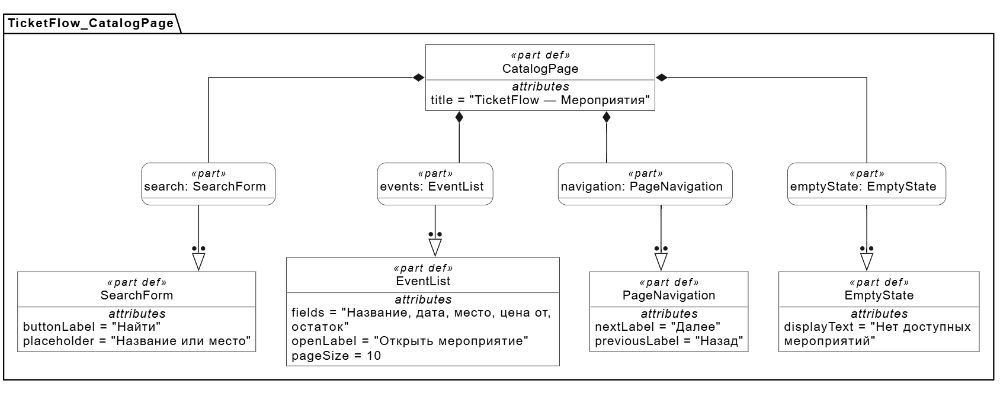
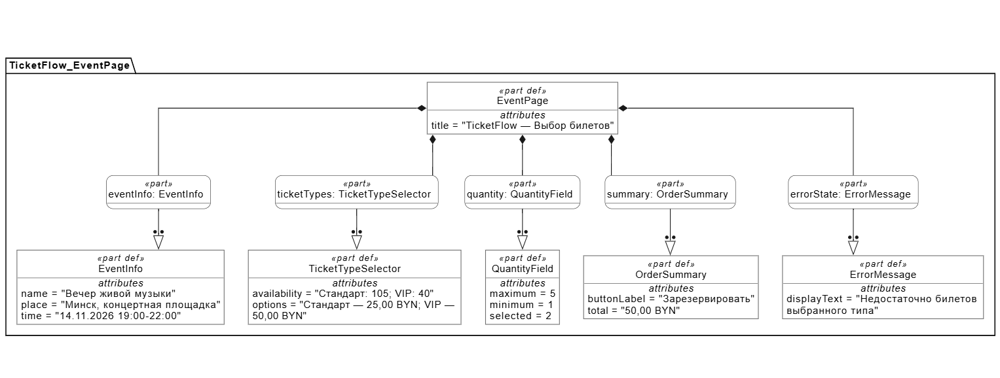
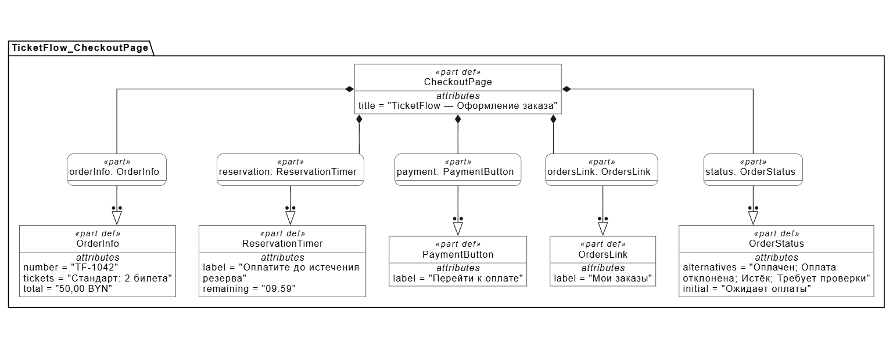
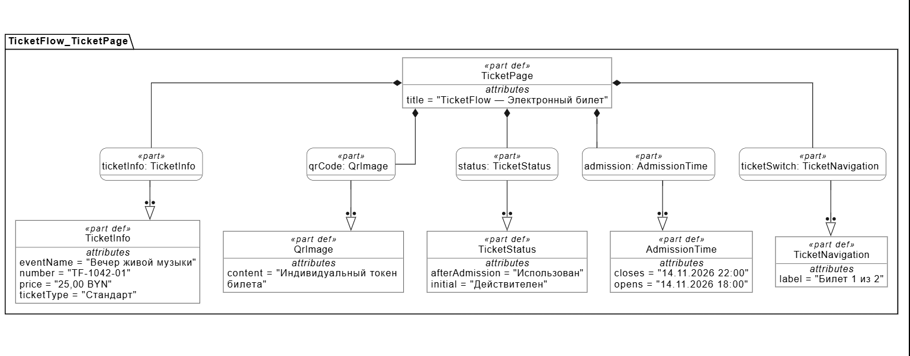
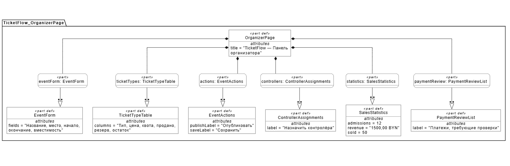
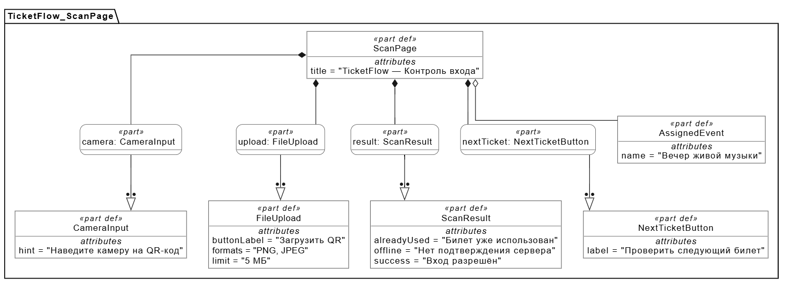

# UI-спецификация TicketFlow

Версия 0.1. Дата 20.10.2026. Основные требования: [подраздел 3.1.1 SRS](../srs.md#311-пользовательские-интерфейсы-311-user-interfaces).

## Общие правила

Язык — русский; основные суммы имеют формат `25,00 BYN`, время мероприятия показывается в Europe/Minsk. Страница содержит навигацию «Мероприятия» и «Мои заказы», действия сотрудников отображаются по роли. Видимость кнопки не заменяет серверную проверку прав. При ширине 360 CSS-пикселей блоки располагаются вертикально; при 1440 CSS-пикселях используются колонки. Горизонтальная прокрутка страницы отсутствует. Управление формами с клавиатуры и текстовые состояния проверяются REQ-INT-004.

Графическая часть содержит структурные схемы шести экранов на SysMLv2. Они показывают состав элементов и примеры их содержимого; расположение блоков на диаграммах не задаёт положение полей и кнопок на веб-странице. Полный состав полей, переходы и бизнес-правила задаются текстом SRS и этой спецификации. Значения статусов и сообщений на схемах являются альтернативами, из которых при работе отображается соответствующий результат. Элемент `QrImage` обозначает область QR-кода электронного билета.

## 1. Каталог

Элементы: поиск по названию или месту, список опубликованных будущих мероприятий, дата и место, минимальная цена, остаток, переход к выбору билетов и постраничная навигация. Нормальное состояние — до 10 мероприятий на странице; пустое — «Нет доступных мероприятий» с возможностью изменить запрос. Выбор карточки открывает экран мероприятия. Покупка требует входа, просмотр не требует.

Связь: REQ-FUNC-003–005.

## 2. Выбор билетов

Элементы: сведения о мероприятии, таблица типов с ценами и остатками, выбор типа, количество 1–5, сумма, кнопка резервирования и пояснение срока оплаты. Значения вне диапазона получают ошибку у поля. Недостаточный остаток — «Недостаточно билетов выбранного типа. Уменьшите количество». Успех открывает сохранённый заказ с серверным сроком резерва.

Связь: REQ-FUNC-002, 006–008.

## 3. Оформление заказа

Элементы: номер заказа, мероприятие, тип, количество, зафиксированная цена и сумма, обратный отсчёт до серверного срока, текущая учётная запись, кнопка перехода к оплате и переход в личные заказы. До подтверждения сервера статус — «Ожидает оплаты»; при истечении — «Резерв истёк» и предложение нового заказа; при позднем успехе — «Платёж требует проверки организатором». Таймаут обращения к оплате не выдаёт билет; повтор использует тот же заказ и платёжную сессию.

Связь: REQ-INT-003, REQ-FUNC-008–011.

## 4. Электронный билет

Элементы: мероприятие, дата и место, тип, цена, номер билета, QR, текст состояния, время открытия входа и переключатель отдельных билетов заказа. Личные заказы доступны только владельцу. Состояние «Действителен» сменяется на «Использован» после допуска; повторное открытие показывает тот же токен и актуальное состояние. Неоплаченный заказ не содержит QR-билетов. Пустой список личных заказов — «У вас пока нет заказов».

Связь: REQ-FUNC-012–015.

## 5. Управление мероприятием

Элементы: статус мероприятия, количество продаж и допусков, сумма продаж, таблица типов и остатков, поля цены и квоты, кнопка сохранения, назначения контролёров и список проблемных платежей. Создание мероприятия запрашивает поля REQ-FUNC-001; публикация доступна при корректных данных и минимум одном типе. Ошибка квоты показывает допустимый минимум; превышение вместимости отклоняется без сохранения. Просмотр чужого мероприятия для управления запрещён.

Связь: REQ-FUNC-001–003, 017–018.

## 6. Контроль входа

Элементы: назначенное мероприятие, окно камеры, загрузка PNG/JPEG до 5 МБ, одно сообщение результата и переход к следующему билету. Отказ разрешения камеры оставляет загрузку файла. Успех — «Вход разрешён» с номером и типом; повтор — «Билет уже использован» с временем первого прохода. Неизвестный код, другое мероприятие, ранняя/поздняя проверка и отсутствие связи дают отдельные текстовые причины. Неподтверждённый ответ не показывается как успешный допуск. Цвет каждого результата дублируется словами.

Связь: REQ-INT-002, REQ-INT-004, REQ-FUNC-014–016.

## Обозначения и получение изображений

Диаграммы построены в Visual Paradigm SysML v2 Studio по текстовым моделям SysMLv2 и сохранены в PNG. Использовано представление Tree.

- `part def` — определение элемента экрана, например `SearchForm` или `OrderSummary`.
- `part` — элемент, включённый в конкретный экран, например `search : SearchForm`.
- Чёрный ромб обозначает включение элемента в состав экрана.
- Стрелка с полым треугольником связывает элемент с определением его типа.
- `attributes` содержит подписи, поля и примеры значений для согласования требований.
